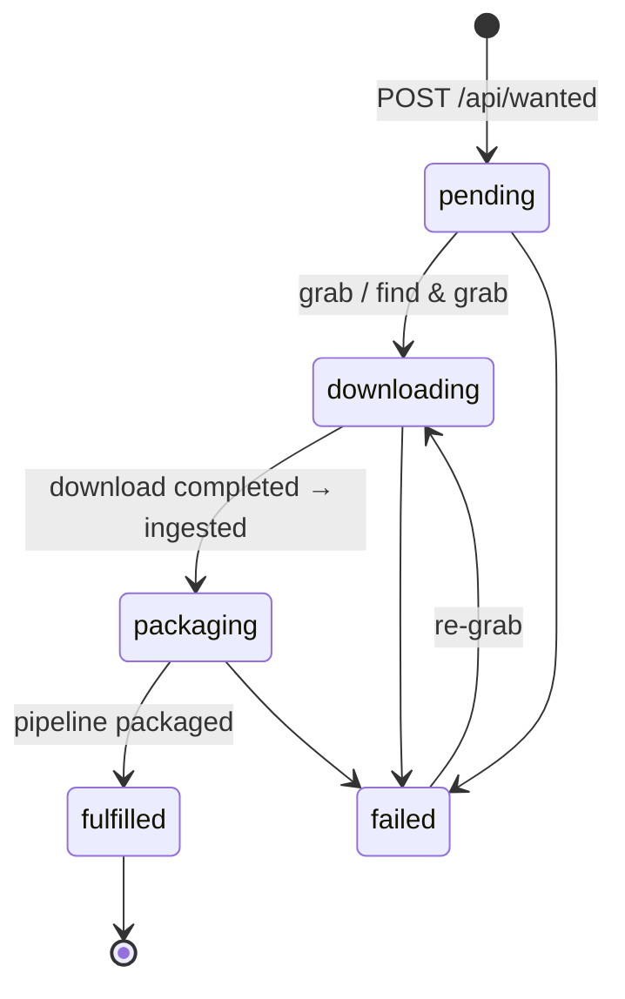
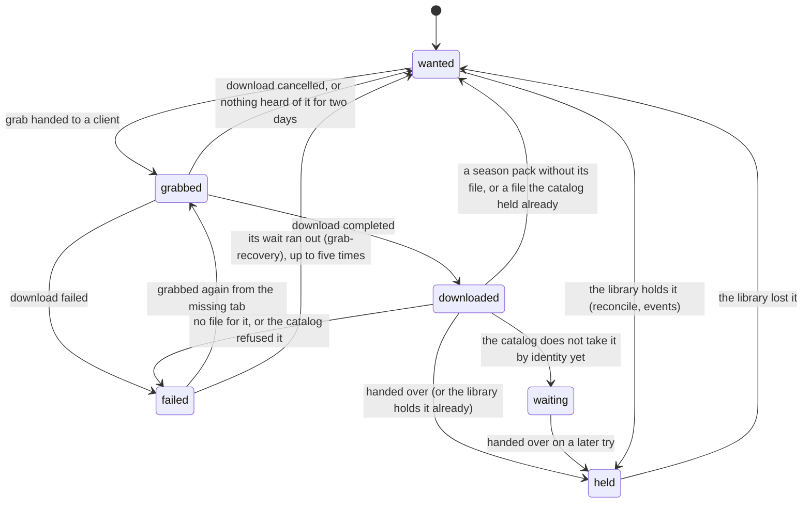

# The acquire service

`acquire` (Go, module `github.com/laedeli/acquire`) is the addon's brain and face.
It records requests and follows the series and movies they ask for, reads
TMDB again for what is still running, watches the sources' newest releases,
drives grabs, reacts to download and pipeline events,
downloads subtitles from OpenSubtitles.com in the configured languages, and serves its console: a federated module the portal hosts. acquire has **no page
of its own** — the portal is the shell, and the console opens in place there,
at `/portal/app/acquire`, on the portal's sign-in. The service serves the
console's bundle under `/embed/` and its API under `/api/`, and sends a browser
that asks it for a page to the portal (see [the console](#the-console) and
[Deploying the addon](./deploying.md#where-the-console-is)).

## Request lifecycle

A request is a **WantedItem**. A request for a series or a movie with a TMDB
id **follows** its title ([below](#a-request-that-follows-its-title)); one
without — a title typed by hand, a release grabbed from the search tab that
no request covers — is a request of its own, and its `status` walks a small
state machine:



- **pending** — the request exists (v1 is auto-approved: it simply waits for an
  admin to grab it).
- **downloading** — a source was handed to a download client. The detail line
  records how, e.g. `grabbed NZB from <source> via nzbget` or `grabbed via qbittorrent`.
- **packaging** — the download finished; acquire resolved the video file and
  ingested it (`ingested; pipeline running`) — copied into the library's
  arrivals first when the download lies outside them (`downloaded; copying into
  the library` meanwhile, still *downloading*).
- **fulfilled** — the pipeline packaged the item; it now plays in chino. A
  request whose movie the library holds already — the catalog answers `409`
  naming the item — is fulfilled by that item.
- **failed** — any of: grab error, no releases (naming the sources that did not
  answer), download failed, no video file in the completed download, or ingest
  error. The detail line carries the reason. `pending` and `failed` requests are
  re-grabbable. A grab that is merely **refused** — no download client for the
  protocol, not enough free space, too many downloads at once, a source out of
  downloads for the day — leaves the request as it was; one that waits for room
  on the downloads volume says so in its detail line.

A request's movie is handed over with its TMDB identity (`identity`), and by
title alone, as before, when the catalog does not take ingest by identity or
refuses the identity.

### A request that follows its title

A request for a **series** (`mediaType` `series`, or TMDB's `tv`) or a
**movie** with a `tmdbId` makes acquire follow the title: it tracks it as it
tracks an imported title — the title with the TVDB and IMDb ids TMDB's
external ids name and the other titles TMDB knows it by as aliases, its
seasons, and its [targets](#episodes-and-movies-acquire-tracks), derived from
TMDB as the inventory derivation derives them: one per episode of a series
(specials left out), monitored, or the one of the movie. TMDB is read for it
at once, in a worker of its own ([TMDB, read again](#tmdb-read-again)), and the
catalog is then asked what the library holds of it. Without `TMDB_API_KEY`
nothing of it can be read, and the request says so.

- **A series request** is never grabbed as a whole and never fails: it stays
  open — **following** — while the series runs, and says how far acquire is
  with it (`13 episodes: 6 in the library, 2 on the way, 1 missing, 4 not
  aired yet; next S01E10 on 2026-10-30`). Its episodes are grabbed as targets:
  on their own with [`search.autoGrabNew`](#what-is-grabbed-on-its-own), or
  from the missing tab. It is **fulfilled** once TMDB says the series has
  ended and the library holds every monitored episode.
- **A movie request** is its movie's target, wanted from the start and
  searched from its release on, as TMDB's release dates say: its first
  release to watch at home — digital, physical or TV, in any country —, or,
  when TMDB dates none of those, 90 days after it came to cinemas. Until then
  it is **waiting** (`out digitally on 2026-11-25; searched from then on`),
  and while TMDB dates nothing at all it waits for a date. Then it reads as
  its target is: **pending** while it is searched for, **downloading**,
  **packaging** once the library holds it, **fulfilled** once it plays,
  **failed** when its last grab failed — tried again on its own. **find &
  grab**, **releases** and **magnet** grab the movie's target, so a request,
  the sweep and the sources' newest releases never grab it twice.

A title acquire tracks already is not made twice: the request follows it, and
it is monitored again, with its seasons to come. Its episodes from before —
the import's — stay the old backlog ([what is grabbed on its
own](#what-is-grabbed-on-its-own)). Asking for a title again answers the
request there is; a request from before follows existed (a series request
that failed, as they did) follows its title once it is asked for again.
Removing the last request that follows a title ends the follow: a title the
request created is no longer monitored, so nothing of it is hunted any more;
one acquire tracked before keeps what it had.

## Episodes and movies acquire tracks

The titles acquire tracks — the series and movies a request follows
([above](#a-request-that-follows-its-title)), and those imported from an
earlier automation service (`POST /api/import/intent`), their episodes derived
from TMDB (`POST /api/import/inventory`) — have **targets**: one per episode,
one per movie (a movie imported as released, a requested one from the
start). A target is what acquire hunts; the library's own word on what it
holds comes from the catalog ([what the library holds](#what-the-library-holds)).
TMDB is read again for what runs, so the episodes it announces later become
targets too ([TMDB, read again](#tmdb-read-again)).

### A grab bound to targets

A **target grab** is one release handed to a download client for every
target it covers. What it covers is read from the release's name: one episode
(`S04E07`, `S04.E07`, `S04-E07`, `S04 EP07`, `4x07`, `Season 4 Episode 7`),
episodes of one season (`S04E07E08`, `S04E07-E08`, `S04E07-08`, `4x07x08` —
a run; `S01E01E03` holds episodes 1 and 3 only, which is no run), or whole
seasons, a **season pack** (`S01`, `S01-S03`, `S01.S02.S03`, `Season 2`) — of
a pack, the aired episodes of its seasons. A name of a daily show (a date) says
nothing. Of what it covers, the grab takes the targets that are wanted or
failed; held ones, and ones another grab is under way for, are left to that.

It is **reserved** first — one conditional update per target, so of two grabs
racing for a target exactly one takes it — then handed over through the same
hand-over a request's grab uses (the release file fetched by acquire, the
grab's id `tg_…` given to the gateway as the wanted item id), then bound to the
client's job. Once the add is sent, it and what records it run to their end
even if whoever asked goes away. A hand-over that does not happen fails no
target:

- **the source or the gateway cannot be had for now** — out of reach, failing
  (5xx), busy (429), timing out, refusing the key, an error page where the
  release file should be: the reservation goes, the targets stay wanted and
  are due again on a later sweep (half an hour), and a sweep stops its run
  when it is the gateway;
- **the release cannot be had** — its file gone from the source (404, 410),
  larger than acquire fetches, a link the endpoint policy refuses, or the
  client rejecting it: it is blocked for the targets, and the next release is
  taken;
- **the add's answer was lost** — sent, but the connection dropped or the
  answer could not be read, so the gateway may have it: nothing is undone. The
  reservation stays, saying so, the sweep leaves the targets alone, and the
  download's first event binds the grab — or, when none comes, the stale-grab
  sweep gives it up ([when a grab fails](#when-a-grab-fails)).

Grabs come from six places:

- the **backlog sweep**, as the search and grab policy allows
  ([the sweep](#the-backlog-sweep), [what is grabbed on its
  own](#what-is-grabbed-on-its-own));
- the **sources' newest releases**, as the policy allows
  ([the newest releases](#the-sources-newest-releases));
- a **request that follows its movie**: its **find & grab**, **releases** and
  **magnet** grab the movie's target ([above](#a-request-that-follows-its-title));
- the console's **missing** tab: **grab now** in a row's action menu, **grab
  all** on a season's group, or **grab N selected** for the rows ticked — a
  search and grab of the best release an automatic grab may take,
  queued and done one at a time by acquire's grab worker. While as many
  downloads are in flight as the policy allows, a queued grab waits, unsearched,
  and says so; a grab refused for another reason (no client for the protocol,
  no room) is taken off the queue saying why;
- **pick a release** in a row's action menu: the target's typed search, each
  release saying what it holds; the one picked is grabbed for every wanted
  target it covers;
- the **search** tab: a release whose name holds episodes of a tracked series
  is grabbed for that series' targets. One of a series acquire does not track,
  or of several, is refused rather than filed as a movie request — and so is
  one that names a tracked series (and its year, when it names one) but no
  episode.

An automatic grab — the sweep's, a newest release's, and the missing tab's
**grab** — takes a release only when it holds the episode alone, or one run of
at most ten episodes in a row, every one of them missing: tracked, aired,
monitored, wanted or failed, not reserved by another grab, not left for
someone to look at. Anything more — a longer range (`S01E01-E12`), episodes that are not one
run, a season pack, several seasons — spends disk and bandwidth on what may
not be missing, or cannot go over as one file. It is grabbed when someone picks
it.

### A target's states



- **wanted** — not held, nothing under way. Aired (a requested movie: out),
  monitored and of holdings acquire knows, it is **missing**.
- **grabbed** — a release that covers it is with a download client; the detail
  line says which (`grabbed NZB S04E07 from <source> via nzbget`).
- **downloaded** — the download finished; acquire is copying it into the
  arrivals, or handing it over.
- **waiting** — the catalog does not take episodes by identity yet: the copy
  stays, the client keeps the download, and the hand-over is tried again.
- **held** — the library holds it: the item, the item whose file it is held
  through when another episode's file covers it, and whether it plays.
- **failed** — its release failed it: the download failed, the download holds
  no file for it, or the catalog refused the file. The detail line says which.
  The release is blocked for it, so the next grab picks another, and it is
  wanted again after a wait ([when a grab fails](#when-a-grab-fails)). A
  failed target is still missing and can be grabbed again from the missing
  tab at any time; the sweep leaves it until its wait ran out.

### When a grab fails

Only its release fails a target. Such a target is **wanted again** after six
hours, twelve after a second failure, then a day and two days, the releases
that failed it blocked for it (for two weeks): the next grab takes another.
After the fifth failure in a row it stays failed, and its detail says so
(`failed 5 times, not tried again on its own: …`), for someone to look at; a
grab from the missing tab still takes it, and holding it ends the count.

Nothing else fails a target. A grab that cannot happen leaves it wanted
([a grab bound to targets](#a-grab-bound-to-targets)). **Cancelling** a target
grab's download in the downloads tab gives the grab up at once: its targets
are wanted again with the release blocked for them, and a hand-over still
waiting for the catalog stops, its copy deleted. A grab in flight that
**nothing is heard of for two days** — no event of its download, no import
working on it — and that the gateway does not know, by the grab's id or by its
client job, is given up and its targets are wanted again: a hand-over that died
before its job was bound, a job its client lost. A gateway that cannot be asked
gives nothing up.

The download's events move only targets that are still the grab's and in the
state the event expects: a completed event moves grabbed targets to downloaded,
a failed one fails grabbed targets. One for a grab that is done or given up —
a repeat, a late event — moves nothing, so a failed target stays failed for its
recovery.

The `grab-recovery` schedule, hourly, does both: it makes the failed targets
whose wait ran out wanted again, and gives up the stale grabs.

### From download to catalog

A target grab's finished download goes to the import worker, which takes it
like a request's: copied into the arrivals when it lies outside them, at
`<arrivals>/acquire/<grab>/<client>-<job>/`, handed over in place otherwise.
Then, file by file:

1. **Which file is which episode.** The download's videos — samples and the
   folders of extras left out — are read by their names: a file goes for the
   episodes its name holds (`Show.S04E07.mkv`, `Show.S04E07E08.mkv`), and a file
   named after nothing in a folder named after its episode for that episode. Of
   two files for one episode the larger is taken. A download whose only file
   names no episode is the release itself, and goes for what the release's
   name holds. A file that holds no target of the grab — an episode held
   already, or not wanted — is left out, and the grab's detail line names it
   with why; so is a file whose name lists episodes that are not one run
   (`S01E01E03`), which one file cannot go over for. A target no file holds
   fails by its release — except of a season pack, which only lets it go: it
   is wanted again, the pack blocked for it, nothing failed. When files of
   such a pack's download name no episode, one of them may be it: the client
   keeps the download.
2. **By identity.** Each file goes to `POST /api/ingest` as an episode of its
   series, named by every identity acquire holds of it — TMDB first, then TVDB
   and IMDb, since the catalog tries them in that order and the first that
   finds a series decides — with its season, its episode and, for a file of
   several, `episodeEnd`:

   ```json
   {"path": "/…/arrivals/acquire/tg_…/nzbget-42/Show.S04E07E08.mkv", "type": "episode",
    "title": "Show", "year": 2019, "series": {"tmdb": "97546", "tvdb": "362753"},
    "seasonNumber": 4, "episodeNumber": 7, "episodeEnd": 8}
   ```

   A movie target goes with its own identity (`identity: {tmdb, imdb}`), and by
   title alone when the catalog refuses it. An id that is not in its source's
   form is left out. A file of more than ten episodes in a row — only ever a
   pick — is not handed over, since the catalog takes at most ten in one file:
   its episodes fail by their release, saying so.
3. **The answer.** The first episode of a file is held by the item the catalog
   answers. The episodes the file covers after it are held through that item's
   file until the holdings name each one's own item: the answer's `covered`
   leaves out an episode the library held already, so it names no episode in
   order, and a reconcile of the series is asked for. The holder's packaged
   event — the only one a file of several gets — makes them all playable, and
   the holder's removal takes them all. A reconcile in the half hour after a
   hand-over does not want its episodes again for not being listed:
   katalog-api may not list them yet.
4. **Held already.** A `409` naming an item says the file was not taken in:
   the library holds what it is already. The episode it names — the file's
   first, by which the catalog refuses a file of several — or the movie is held
   by that item, with nothing recorded of the quality of a file acquire did not
   bring, and a reconcile of the series checks it. Every other episode of that
   file is not in the library by it: it is wanted again, with the release
   blocked for it, so the same release is not grabbed for it once more.
5. **A catalog without the contract.** The catalog from before ingest by
   identity answers an episode with `400` asking for its parent's catalog id;
   that, or a `422`, leaves the targets **waiting**. The copy stays, the
   download is not released in its client, and the hand-over is tried again
   half an hour after the first refusal and up to six hours apart. Any other
   refusal — a path outside the arrivals, an id in the wrong form — fails the
   targets by their release, with the catalog's reason.

The import moves only targets that are still the grab's and in flight: one a
reconcile held meanwhile stays held. A copy the catalog did not take — refused,
or held already — is deleted from the arrivals; only a hand-over waiting for
the catalog keeps its copy.

The download is **released** in its client — for the clients the deployment
runs, as a request's is — only when every target the grab still holds is held,
its file handed over and taken or held already, and nothing of it went over in
place: a file handed over where it lies (no `ACQUIRE_ARRIVALS_ROOT`, or a
download inside the arrivals) is the library's own, and its client keeps it.
Otherwise — a file refused, a target without a file, a file of several the
catalog held only the first episode of, a pack without a file for an episode
and with files that name none — the grab fails saying why, each target says
so, and the client keeps the download for someone to look at.

### What the library holds

acquire learns what the library holds from katalog-api's **holdings by
identity** (`GET /api/v1/holdings`, ADR-0012 of the platform), and never keeps
a copy of the catalog:

- **The reconcile.** For every tracked series and movie, acquire asks what the
  library holds of it — by its TMDB id, then its TVDB id, then its IMDb id, one
  per request — and makes its targets match: an episode the answer lists is
  held (with its item, the item whose file covers it, and whether it plays), a
  held one it does not list is wanted again. A series the catalog holds twice
  is answered as one, with the episodes of every copy: an episode both hold is
  held by the copy that plays, else one with a file of its own. A `404` for a
  title is "nothing of it is held" — unless the catalog holds a title of its
  name (and year, when both have one) **without any identity**, which no
  lookup by identity can find: then its holdings are unknown, saying so, until
  that item carries an identity. That is read from the listing, once per
  reconcile, when a lookup first finds nothing. A probe of the listing first
  tells a catalog that has no holdings endpoint (`404`, `405` or `501` there,
  or something that is not a page) from one that holds nothing: against the
  former, every title's holdings become unknown. A read side that is down, or
  refuses acquire's service account, keeps what was known and says why on
  each title.
- **When.** On the `holdings-reconcile` schedule (every six hours, the first
  run right after the first start), after titles are imported or their
  episodes derived, after a follow or a read of TMDB added targets, after a
  hand-over the catalog answered "held already" or
  that held a file of several, and on **ask the catalog now** in the missing
  tab (`POST /api/holdings/reconcile`). The reconcile runs in a worker of its
  own; the event that asks for it waits for nothing.
- **Between runs, the catalog's events.** `catalog.item.discovered` and
  `catalog.item.packaged` hold the target their identities name — an episode
  by its series' identities (`seriesExternalIds`) and numbers, a movie by its
  own (`externalIds`) — and `packaged` makes what the item holds playable,
  together with the episodes held through its file; it also asks the holdings
  to confirm the series, which covers a file of several acquire did not grab.
  `catalog.item.removed` makes what the item held wanted again: hunted again
  while the target and its title are monitored, not otherwise. An event
  without identities is matched by the item id acquire recorded.
- **Holdings unknown.** Until a title's holdings are known — never reconciled,
  or the catalog cannot answer — its targets are **holdings unknown**: not
  missing, not swept, and never grabbed automatically, because nothing says
  they are not on disk. The missing tab says how many titles that leaves out
  and why; the series tab marks each one. So is a target a follow or a read
  of TMDB added since its title's holdings were last learned, until the
  reconcile that addition asks for: the library may hold that episode
  already.

A holding acquire tracks no target for is ignored: the library holds things
nobody monitors, and they must not become things acquire hunts. A movie the
library holds gets its one target.

### The backlog sweep

On its schedules (`backlog-sweep` every 30 minutes, `retry-failed` every 15
for targets whose searches keep finding nothing), the sweep takes ten targets:
wanted, aired, monitored with their title, of holdings acquire knows,
not reserved by a grab under way, due — the ones never searched first, then the
ones searched longest ago; with `search.autoGrabNew` on, the new things
([what is grabbed on its own](#what-is-grabbed-on-its-own)) before all others,
so they do not wait their turn behind the old backlog. It searches each with
its typed search and records the outcome on the target:

| Outcome | Next search |
|---|---|
| **found** — releases an automatic grab may take | in twelve hours (on the next sweep when a grab was refused) |
| **none** — nothing, or nothing acceptable | 30 minutes after the first miss, doubling, up to a day |
| **error** — the search itself failed | the same backoff |

So every searched target moves to the back, and the sweep works through the
whole backlog.

The sweep **grabs only what the search and grab policy lets it**: with
`search.autoGrab` everything it finds, with `search.autoGrabNew` the new
things alone ([what is grabbed on its own](#what-is-grabbed-on-its-own)). Both
are off by default: then it only searches, and missing episodes are grabbed
from the missing tab. It grabs the best release an automatic grab may take of
each target it may grab and found releases for — never one whose holdings are
unknown, and only while a download slot is free (the downloads in flight the
gateway reports, and the grabs handed over it has not reported yet, against
the downloads at once of the search and grab settings). The first grab refused
for room, a slot or a client stops grabbing for the rest of that run; the
gateway not taking adds — out of reach, failing, its answer lost — stops the
run: the rest would be searched, spending the sources' allowance, for grabs
that cannot be handed over.

acquire reacts to these consumed events:

- `download.client.started` / `.progress` → record live telemetry (state, bytes,
  speed, ETA, seeders/health) and stream it to the console.
- `download.client.completed` → resolve the video file → `POST /api/ingest` →
  `packaging`, or, for a download outside the arrivals, queue its copy (below).
  A target grab's download is always queued for the import worker
  ([from download to catalog](#from-download-to-catalog)). Idempotent: a
  repeat (e.g. after a gateway restart) is ignored once the request or the
  grab has moved past the download, and queues nothing twice; one for a grab
  that failed or was given up moves nothing.
- `download.client.failed` → `failed` (with the client's error); a target
  grab's targets that are still grabbed fail by their release: blocked for
  them, wanted again after a wait ([when a grab fails](#when-a-grab-fails)).
- `catalog.item.packaged` → look up the request by item id → `fulfilled`; the
  targets the item holds are held and playable
  ([what the library holds](#what-the-library-holds)); and the item is a new
  arrival for [subtitles](#subtitles), searched first.
- `catalog.item.discovered` / `.removed` → the targets the item holds are held,
  or wanted again. These two are read in a consumer group of their own, the
  main group's id followed by `-catalog`: a group whose topics include one that
  does not exist is assigned nothing at all, so a catalog topic missing on an
  instance stops only these.

**Resolving the video file** from a completed download: acquire walks the download
folder as it sees it and picks the **largest** file with a video extension
(`.mkv .mp4 .m4v .avi .mov .ts .webm`). A file inside the library's arrivals it
ingests *in place*. With `ACQUIRE_ARRIVALS_ROOT` set, a file outside them — the
download clients the chart runs work on a volume of their own — is **copied in
first**: a worker takes one import at a time, copies the video and the
subtitle files the catalog pairs with it into
`<arrivals>/acquire/<request>/<client>-<job>/` (one sequential pass per file
into a temporary dot name, synced, checked by size and a SHA-256 of both ends,
renamed into place), and hands the copy over through the same
`POST /api/ingest`. A failed copy or hand-over leaves the download where it is
and is tried again, a minute after the first failure and up to an hour apart.
For the clients the deployment runs, acquire then releases the download in
the client, through the client's own API — an NZB right after its verified
copy, a torrent once qBittorrent stopped it at its seeding goal, removed with
its data. acquire never moves or deletes a client's files itself.

### TMDB, read again

The episodes acquire hunts are TMDB's. The import's derivation read them once;
the `inventory-refresh` schedule (every six hours) reads them again, so what
TMDB announces later becomes a target too — and a follow is read at once, in
the same worker. A read of a series takes its answer (its status, its TVDB
and IMDb ids where acquire has none, its other titles as aliases, its seasons
with their episode counts) and the episodes of the seasons that can have
changed: every season on a series' first read; after that a season acquire
does not know yet, one whose episode count changed, the last one, and one
with an episode that aired in the last 60 days, airs in the next 14 or has no
air date yet. Then:

- a new episode becomes a target, wanted — monitored as its season is; a new
  season is monitored when its title monitors new seasons, which a followed
  title always does;
- an episode's air date and title follow TMDB's; nothing anyone decided is
  touched — monitoring and state stay as they are;
- an episode TMDB no longer lists (in a season read, or of a season it no
  longer lists) is removed, unless the library holds it or a grab is under
  way for it: those stay. An answer that lists no season at all removes
  nothing;
- the catalog is asked what the library holds of what was added
  ([what the library holds](#what-the-library-holds)).

**What is read when.** A series that runs — TMDB says it returns, is in
production or is planned; before TMDB was read for it, the import says it
continues; or an episode aired in the last 60 days or airs in the next 14 —
is read on every run. One that has ended is read at most weekly. A requested
movie that waits for its release is read daily, for the date TMDB names; one
that is out is not read again. The followed titles never read come first,
then the ones that run, the ones read longest ago first.

**Paced.** The whole library is thousands of calls to read, so a run starts
no title once it has spent 300 calls; what is still due is read on the next
runs. TMDB not answering — out of reach, failing, limiting, refusing the key
— ends the run and fails nothing: the titles stay due, and a request whose
title could not be read says why. A title TMDB does not know is recorded as
failed and read again after its interval.

### The sources' newest releases

The sweep searches the backlog ten targets at a time, so a release that turns
up in between waits for its target's turn. The `rss-sync` schedule (every
fifteen minutes) reads each enabled source's newest releases instead — its
RSS feed — and matches them to what is wanted:

- **What is read.** `t=tvsearch` with the source's TV categories (5000 when it
  names none) and `t=movie` with its movie categories (2000), without a query,
  a hundred releases at a time; a source whose caps offer neither is read
  with `t=search` over the categories it needs. Only what can be grabbed now
  is read for: no TV feed while no episode can be grabbed on its own, no movie
  feed while no movie can, and nothing at all while the policy grabs nothing
  on its own — every read spends a query of the source's daily allowance.
- **Each release once.** A cursor per source and feed — the newest
  publication time looked at, and the releases of that time — makes a release
  looked at once. A feed that moved further than a page since its last read is
  read back a page at a time (`offset`) until the releases read before, up to
  three pages; what is older is left to the sweep. A feed never read is read
  once, its newest page. A release without a publication time is left to the
  sweep.
- **The match.** A series' release is matched by the words before the
  episodes its name holds: the series' title or an alias, exactly — or with
  the series' year or a country (`US`, `UK`, `AU`, `CA`, `NZ`) after it —,
  the way scene names write them (`Example.Saga.Seven.Harbours` for
  `Example Saga: Seven Harbours`). A movie's release by its title or an alias
  and its year; a year off by one only when the feed's IMDb id says it is the
  movie. A name several tracked titles share matches none. When the feed
  carries identities (`tvdbid`, `imdbid` or `imdb`, `tmdbid`), one that names
  another title than the match rejects it.
- **The grab.** Of the episodes a release holds, the first that can be
  grabbed now is what it is for: wanted, aired, monitored, of holdings
  acquire knows, not reserved — and one the policy lets grab on its own. A
  release named for an episode that has not aired is most often a fake, and
  one of a movie not out yet a recording made in a cinema: neither is
  grabbed. Then it is grabbed
  as the sweep grabs: the releases found for a target ranked by its title's
  quality profile, the ones blocked for it left out, only what an automatic
  grab may take (one episode, or one short run of missing ones; never a
  season pack), within the storage floor and the downloads at once, through
  the same [grab bound to targets](#a-grab-bound-to-targets) (its `via` is
  `rss`). A release that cannot be grabbed now — no slot, no room — leaves its
  target due on the next sweep.
- **A source that fails** or limits backs off as it does for any search
  ([its health](./indexers-and-nzb.md#health-backoff-and-allowances)) and fails
  nothing: the other sources are read, and its cursor stays where it was.

### What is grabbed on its own

Two switches of the search and grab settings say what the sweep and the
sources' newest releases grab on their own; both are off by default, and then
nothing is grabbed on its own — the sweep searches, and grabs are asked for in
the missing tab or a request's row.

| Setting | Grabs on its own |
|---|---|
| `autoGrabNew` (`false`) | the **new things**: an episode that aired in the last `newWithinDays` days (`14`), of any tracked series; an episode a follow or a read of TMDB added after its series was first requested — every episode of a series someone requested; a requested movie once it is out |
| `autoGrab` (`false`) | **everything missing**: the old backlog too — the import's episodes and movies, however long ago they aired |

`autoGrab` keeps its meaning; with it on, `autoGrabNew` changes nothing. With
`autoGrabNew` alone, the old backlog — what the import brought, and the
episodes of a tracked series from before it was requested — is searched and
waits for the missing tab. Either way an automatic grab takes only what it may
([a grab bound to targets](#a-grab-bound-to-targets)), within the storage floor
and the downloads at once, and never a title whose holdings are unknown.

## Schedules

acquire's recurring work fires on the platform's event streaming (the clock
writes `acquire.schedule.due`, the consumer acts on it); without brokers
nothing runs on a schedule. Each is registered on start; a row an operator
changed — its interval, or switched off — is left as it is.

| Schedule | Every | Does |
|---|---|---|
| `backlog-sweep` | 30 minutes | searches ten due targets ([the sweep](#the-backlog-sweep)) — the new things first with `autoGrabNew` — and grabs what the policy allows |
| `retry-failed` | 15 minutes | the same for targets whose searches found nothing or failed, once their backoff ran out |
| `rss-sync` | 15 minutes | reads every source's newest releases, matches them to what is wanted and grabs what the policy allows ([the newest releases](#the-sources-newest-releases)); in a worker of its own |
| `inventory-refresh` | 6 hours | reads TMDB for what runs, what ended (weekly) and the requested movies that wait (daily), at most 300 calls a run ([TMDB, read again](#tmdb-read-again)); in a worker of its own, which also reads every follow at once |
| `holdings-reconcile` | 6 hours | asks the catalog what the library holds ([what the library holds](#what-the-library-holds)); in a worker of its own |
| `grab-recovery` | 1 hour | makes failed targets wanted again once their wait ran out, and gives up stale grabs ([when a grab fails](#when-a-grab-fails)) |
| `subtitles-sweep` | 15 minutes | a pass of the [subtitles](#subtitles) worker |
| `outbox-audit` | 6 hours | logs how many events wait in the outbox |

## Subtitles

acquire downloads subtitles from **OpenSubtitles.com** in the configured
languages, for the movies and episodes the library holds that lack one. It
downloads the best match of each language, up to a daily limit, and adds it
to the title through the catalog's subtitle API (katalog-manager
`POST /api/library/items/{id}/subtitles`, origin `provider`). Every player
lists and plays an added subtitle as any other: the catalog writes it beside
the title's package, and nothing is encoded or packaged again. A title no
source has a subtitle for stays under *not found*; nothing else makes
subtitles today.

- **The languages** are, by default, the platform's — the catalog names them
  (`GET /api/library/subtitles/languages`: its `subtitles.languages`, else
  the packager's language whitelist, the languages its players show) — or,
  set for acquire alone, `subtitles.languages`.
- **What a title has** is the catalog's word: its full subtitles, the ones
  that came with the file and those added separately (a forced one doesn't
  count). For Chinese, the language's script decides: Chinese of no script
  (`zh`) counts a subtitle in either script, marked "in Traditional
  characters" for a Traditional one; Chinese of a script (`zh-Hans`,
  `zh-Hant`, or a region such as `zh-CN`, `zh-TW`) counts one in that script,
  or one whose script isn't marked, and not one in the other script, which
  nothing turns into it. A title with only that other one stays open for the
  language, and its row says so ("nothing found · has one in Traditional
  characters · again in 14 days").
- **Without an account and an API key** (`subtitles.opensubtitles.*`), or with
  `subtitles.enabled` false, nothing is searched for; the console and the
  setup checklist say what is missing.
- **A language that is no longer configured** is searched for no more. A
  subtitle acquire added in it stays, and you can remove it in the console.

### What acquire looks at first

acquire makes a pass every fifteen minutes (`subtitles-sweep`), after a
packaged title, when you ask in the console, and at least every half hour:

1. **New arrivals first.** A `catalog.item.packaged` event makes its movie or
   episode a new arrival — named from acquire's targets, else from the
   catalog — whose languages are searched at once. A title packaged again
   (another file, perhaps) is checked again, though it had every language: a
   language its new file lost is searched anew, by the new file's
   fingerprint, and a match found for the file before is dropped.
2. **Then what was asked for**: titles acquire grabbed, or someone requested.
   acquire can't see what is watched; what was asked for is the closest it
   knows.
3. **Then the rest of the library**, the newest first: the movies and
   episodes acquire tracks that the library holds and plays, five hundred a
   pass (an episode another's file covers has its holder's).

A pass first downloads the queued matches, up to the daily limit, then
searches twenty titles, one search each for every language they lack, and
downloads each match at once while the limit lasts. **A search costs no
download**, so acquire searches ahead of the limit; the matches it finds
wait, queued, for a later day's downloads. Before a download acquire asks
the catalog about the title again: nothing is downloaded for a title that
has the language by now, or can't take a subtitle right now, and nothing
while the catalog doesn't answer.

### Finding the match

A title is searched by its IMDb and TMDB ids — a movie's own, an episode's
series' with its season and episode — and by its file's fingerprint: the
catalog reads 128 KiB of the original and answers its size and the 64-bit
sums of its first and last 64 KiB
(`GET /api/library/items/{id}/subtitles?fingerprint=true`), which is how
OpenSubtitles.com matches a subtitle to a file. acquire reads no file of the
library itself. Once the original was deleted after packaging there is no
fingerprint, and the ids and names decide. Of what the search finds, for each
language:

1. **made for this file** — its fingerprint matched — first;
2. **made for this release** — its release name has what tells the file's
   release from another (the release acquire grabbed it from, and what the
   catalog's source record says its name claimed: disc or web, its height);
3. then the **downloads** and the **rating**; one without hearing-impaired
   cues before one with.

Never downloaded automatically, but shown in the console with why: a
**machine- or AI-translated** subtitle (unless `machine translations` is on
in settings), one of the **foreign parts only**, one **in several files**,
and one made for **another title** — a fingerprint can be another film's
when a subtitle was uploaded under the wrong one. One made for **another
episode** is left out of an episode's results altogether, as one in another
language is: the source says which episode it belongs to, and so does its
release's name (S04E07, a run like S04E07E08, 4x07, a season's S04). For
**Chinese** of no script, Simplified (`zh-cn`) is taken before Traditional
(`zh-tw`), whatever the downloads say; Traditional only when there is no
Simplified one, added as `zh-Hant` and shown "in Traditional characters".
Chinese of a script is searched in that script alone (`zh-Hans`: `zh-cn`;
`zh-Hant`: `zh-tw`), and a version in the other script is never offered for
it.

The file is downloaded as SubRip and sent to the catalog as UTF-8: one in an
older encoding is read in the one its language was most often written in
(GB18030 or Big5 for Chinese, Windows-1250 to 1256 by language, else
Windows-1252). The catalog keeps it as WebVTT. A language counts as **had**
only once the catalog lists the subtitle acquire added — never on a download
alone.

### The daily limit, and what waits

`subtitles.dailyBudget` (by default 18) is how many files acquire downloads automatically
a UTC day; a free account allows 20, and the rest of the account's downloads
are for versions you pick in the console. The account's own count is the
limit for everyone — the account may be shared with other tools — so acquire
keeps to what it says it has left (OpenSubtitles.com answers every download
with the day's remaining ones, and acquire asks the account when the day's
count isn't known yet): automatic downloads stop at the daily limit or at the
account's count, whichever comes first, and a version you pick draws on the
account alone, whatever the automatic downloads used, refused only when the
account has none left. A limit of `0` downloads nothing automatically; you
can still pick. The console shows one number, the downloads the account has
left today — what a version you pick takes from. The API is asked one
request at a time, a second apart, and a `429` is waited out as its
`Retry-After` says.

- **Nothing found** — or only what is never downloaded automatically — is
  searched again after a week, two, then four.
- **A failed download or add** needs attention, its line saying what went
  wrong in plain words and what comes next ("can't read the file · tries
  another version in 5h"), the source's or the catalog's own words in its
  details. A file the source refuses, one that can't be read or used, and one
  whose text the catalog refuses are never downloaded again for that title:
  after six hours the next search takes the next version, or, when the last
  search found no other usable one, the line says so ("no other version
  yet") and a new one is searched for after a week, as for nothing found.
  What fails otherwise — a link that doesn't work, a subtitle the catalog
  took and doesn't list — is tried again with the same version after six
  hours. After five failures in a row it waits for you. A catalog or source
  that doesn't answer fails nothing: the match waits, and the pass downloads
  nothing more.
- **A match the daily limit doesn't reach** waits, queued; the console says
  in about how many days its turn comes.
- **A subtitle you remove** is removed from the catalog, its file is never
  downloaded again for that title, and acquire searches for another after a
  day.

With **downloading** off in settings, acquire still searches, and downloads
only what you find (from the daily limit) or pick; the rest of what it finds
waits for you under *waiting*.

### In the console

The **subtitles** tab is a worklist that opens on what needs you. One status
per title and language, in words — *has subtitles* ("came with the file",
"added by acquire · matches this file", "added by acquire · in Traditional
characters"), *on its way* (in today's downloads, or asked for), *waiting*
(not searched yet, or a match waiting for a later day: "found · waits for
the daily download limit (about 22 days)"), *not found* ("nothing found ·
again in 22 days"), *needs attention* ("the catalog refused it · tries
another version in 5h") — with tabs that count each, a language facet and a
search. Under each status a line says why, in plain words, and what happens
next. The source, the release, how it fits, the file's name and the source's
or the catalog's own words are a row's **details**: shown on a row that needs
attention, in the row's menu on the others. A subtitle made by AI reads
"German · AI" — information, not a warning. The header's line of data says
each configured language's coverage and the downloads the account has left
today (for example "English 94% · German 40% · Chinese 13% · 9 downloads left
today"), which it leaves out while the day's count isn't known; how many
automatic downloads were used today, the account's count and where the
languages are set are under its **details**. Every name, number and setting
on the tab is read from the configuration and the account when it is shown —
the source's name too, which the API gives.
With nothing set up and nothing done, the tab says so once, in its empty
state, with **open settings**.

Rows are grouped by series and season, movies in a group of their own. Each
row has one action menu — **pick a version**, **preview**, **details**,
**remove** (an admin has all four) — an admin has **find all** per group,
and **find German for 12 selected** for the rows ticked, which queues them
first; a match that only waits for a later day's downloads is not among
them, as finding it again would change nothing. **Pick a version** shows the
versions OpenSubtitles.com has for the title in that language — for an
episode, that episode's alone — in the order the automatic choice ranks
them, each its release's name, how it fits ("matches this file", "matches
this release", "may be out of sync"), its downloads, its rating and whether
it is a machine translation (AI), for the hearing impaired or Traditional;
how the search was made is under its **details**. **Use this one** downloads
it at once, from the account's own downloads, whatever the automatic
downloads used ("Using one takes 1 of the 9 downloads left today"), and
takes the place of the one acquire added in that language before, which is
removed, its file never downloaded again for the title. The languages, the
account, the daily limit, **downloading** and **machine translations** are
in **settings**.

### Its API

| Method | Path | Who | Purpose |
|---|---|---|---|
| `GET` | `/api/subtitles/overview?language=` | any signed-in | whether it runs and why not, the languages with their coverage, the day's downloads, the settings, the tabs' counts |
| `GET` | `/api/subtitles?tab=&language=&q=&limit=` | any signed-in | a tab's titles and languages (`attention`, `notfound`, `waiting`, `way`, `has`), each with its status, its line and its details |
| `GET` | `/api/subtitles/{itemId}/{language}/search` | **admin** | a search for one title and language: every version found, ranked, saying how it fits and why one is never downloaded automatically |
| `POST` | `/api/subtitles/{itemId}/{language}/pick` | **admin** | download one of them and add it, at once (sends back the version) |
| `DELETE` | `/api/subtitles/{itemId}/{language}` | **admin** | remove the subtitle acquire added |
| `GET` | `/api/subtitles/{itemId}/{language}/preview` | any signed-in | the first cues of the subtitle acquire added |
| `POST` | `/api/subtitles/find` | **admin** | queue searches for `{"keys": [{"itemId", "language"}, …]}`, first, at most 500; `202 {queued, skipped}` |
| `GET` · `PUT` | `/api/settings/subtitles` | **admin** | `auto` (downloading on its own, `true`) and `allowMachineTranslated` (`false`); a `PUT` sends its revision in `If-Match` |

## HTTP API

Router: `go-chi`. Auth is an OIDC bearer verifier (issuer-only; roles from the
JWT `realm_access.roles`). If `OIDC_ISSUER` is unset, auth is disabled for local
dev (every caller is treated as admin).

| Method | Path | Who | Purpose |
|---|---|---|---|
| `GET` | `/healthz` | public | liveness |
| `GET` | `/readyz` | public | DB ping (503 when down) |
| `GET` | `/api/config` | public | what the console reads: the admin role and the `autoGrab` flag — whether **find & grab** has a source and a client to work with, not the sweep's `search.autoGrab` |
| `GET` | `/api/events` | any signed-in¹ | live stream: change pings + download telemetry |
| `GET` | `/api/wanted` | any signed-in | list requests; one that follows its title reads as what acquire does with it now, with `titleId`, `progress` (a series' episodes held, on the way, missing, not aired yet, the next to air; a movie's target) and `autoGrab` (whether what it waits for is grabbed on its own) |
| `POST` | `/api/wanted` | **user** or admin | create a request `{tmdbId, mediaType, title, year, posterUrl}`; a series (`series`, `tv`) or a movie with a `tmdbId` follows its title; asking for one again answers the request there is |
| `GET` | `/api/discover?q=` | any signed-in | TMDB search, flags in-library hits |
| `GET` | `/api/status?tmdbId=` | any signed-in | status of the newest request for a TMDB id, as it reads now |
| `POST` | `/api/wanted/{id}/grab` | **admin** | hand a magnet/URL to a client (a request that follows its movie: as a grab of the movie's target) |
| `POST` | `/api/wanted/{id}/autograb` | **admin** | search the sources + grab the best release (a request that follows its movie: its target's typed search and grab; a series request: refused, its episodes are grabbed one by one) |
| `GET` | `/api/wanted/{id}/releases` | **admin** | the ranked releases for a request `{candidates, incomplete}` (a followed movie: its target's typed search) |
| `POST` | `/api/wanted/{id}/pick` | **admin** | grab one of them (sends back its `release` reference) |
| `GET` | `/api/search?q=&indexers=` | **admin** | manual search across the sources `{candidates, incomplete}` |
| `POST` | `/api/search/grab` | **admin** | grab a manual search result |
| `DELETE` | `/api/wanted/{id}` | **admin** | remove a request; the last one that follows a title ends its follow |
| `GET` | `/api/downloads` | any signed-in | live + recently finished downloads |
| `GET` | `/api/clients` | any signed-in | per-client health + aggregate speed |
| `POST` | `/api/downloads/{adapter}/{id}/{action}` | **admin** | `pause` \| `resume` \| `cancel` (a target grab's download: the grab is given up at once, its targets wanted again) |
| `GET` | `/api/setup` | **admin** | the setup checklist: sources, clients, grab policy |
| `GET` | `/api/health/system` | public | diagnostic checks (database, outbox, storage, sources, clients, clock); always 200 |
| `GET` | `/embed/…` | public | the console's bundle: `assets/remoteEntry.js`, its chunks and `assets/console.css` |
| `GET` | `/` and any other page | public | `302` to acquire's app in the portal (see [the console](#the-console)) |

¹ The stream carries download telemetry (progress, speed, ETA), so it is
authenticated. Clients read it with **fetch-streaming** rather than
`EventSource`, which cannot send an `Authorization` header. It emits `changed`
(refetch the lists) and `download` (one telemetry row, applied in place).

### The backlog and its grabs

| Method | Path | Who | Purpose |
|---|---|---|---|
| `GET` | `/api/missing?limit=` | any signed-in | the backlog: aired, monitored targets the library does not hold, of holdings acquire knows, each with its state, detail and last search `{missing, holdings: {known, unknown, reason, lastAt}, autoGrab, autoGrabNew, newWithinDays}` — the last three what is grabbed on its own |
| `GET` | `/api/series` | any signed-in | every tracked series with episodes, held, missing, on their way, unaired, whether its holdings are known, and whether a request follows it (`followed`) |
| `GET` | `/api/counts` | any signed-in | the headline numbers, with the titles and targets of unknown holdings |
| `GET` | `/api/targets/{id}/search` | **admin** | a target's typed search `{candidates}`, each saying what it holds (`covers`, `pack`) |
| `POST` | `/api/targets/{id}/pick` | **admin** | grab one of them, bound to every wanted target it covers (sends back its `release` reference) |
| `POST` | `/api/targets/grab` | **admin** | queue a search and grab for each of `{"targetIds": […]}`, at most 200; `202 {queued, skipped}` |
| `POST` | `/api/holdings/reconcile` | **admin** | ask the catalog now what the library holds; `202` |

### Configuration API

Search sources, download clients and the search and grab policy are acquire's
own data, edited by admins only:

| Method | Path | Purpose |
|---|---|---|
| `GET` · `POST` | `/api/indexers` | list · add search sources |
| `PUT` · `DELETE` | `/api/indexers/{id}` | replace · remove a source |
| `POST` | `/api/indexers/test` · `/api/indexers/{id}/test` | try an unsaved · a saved source |
| `GET` · `POST` | `/api/download-clients` | list (with live gateway state) · add download clients |
| `PUT` · `DELETE` | `/api/download-clients/{id}` | replace · remove a client (`409` while downloads are in flight, and for a managed client) |
| `GET` | `/api/download-clients/types` | the client types the gateway runs |
| `POST` | `/api/download-clients/test` | reach a client through the gateway without saving it |
| `GET` · `PUT` | `/api/settings/search` | the search and grab policy: `preferProtocol`, `storageFloorGb`, `maxConcurrentGrabs`, `autoGrab` (everything missing is grabbed on its own; `false` by default), `autoGrabNew` (the new things are; `false`) and `newWithinDays` (how recently an episode aired to be new; `14`, 1 to 365) — see [what is grabbed on its own](#what-is-grabbed-on-its-own). A `PUT` replaces the whole document; one that names no `newWithinDays` takes the default |

Writes send the revision they were based on in `If-Match` and get `409` when it
is stale; invalid content gets `422 {"fieldErrors":[…]}`. A **managed** client
(`"managed": true`) is one the deployment runs and declares in
`ACQUIRE_MANAGED_CLIENTS`; acquire writes it at start from that declaration, and
the API refuses to replace or remove it (`409`), though it can be tested. Secrets — source API
keys, client passwords and tokens — are write-only: omit to keep, a string to
replace, `{"clear":true}` to remove; reads say only whether one is set. Every
write is recorded in `settings_audit` without its values. See
[Search sources & NZB-first](./indexers-and-nzb.md) and
[Download gateway & clients](./download-gateway.md).

### Roles

| Role (default) | Env | Can |
|---|---|---|
| `zaentrum-user` | `ACQUIRE_USER_ROLE` | request titles |
| `zaentrum-admin` | `ACQUIRE_ADMIN_ROLE` | request **+** grab, auto-grab, remove, search, configure |

## The console

A Vite/React/TypeScript app on the nalet design system, built into the binary
with `go:embed` (source in `web/`, one container — no nginx sidecar). It is a
**federated module** and nothing else. The portal shell loads
`/embed/assets/remoteEntry.js` through its app proxy
(`/api/portal/apps/acquire/`), renders the exposed `Console` inside its own
React tree (React and react-dom are shared; no iframe) and links
`assets/console.css`. The shell signs the user in and hands the console the
API base and the user's access token; a `401` goes back to the shell, which
signs the user in again. acquire has no sign-in, no OIDC client and no page of
its own. **Realm roles come from the ACCESS token** — the ID-token profile
carries none, so reading it makes every user look like a non-admin.

Each tab has a hash route inside the app's route —
`/portal/app/acquire#/requests`, `#/downloads` and so on — which the launchpad
tiles open.

A browser that asks acquire itself for a page — `/`, or any other path the
standalone console of earlier versions answered — gets a `302` to
`ACQUIRE_PLATFORM_URL` followed by `/portal/app/acquire`. A search (`?q=`) is
carried and nothing else of the query, so a stale sign-in callback never
reaches the portal; the browser keeps the place in the console (`#/downloads`).
Without `ACQUIRE_PLATFORM_URL` the redirect goes to the portal's root,
`/portal/`, on the host the browser asked. Unknown `/api/` paths, missing files
of the bundle and other methods are a `404`, never a redirect or a page.

Tabs:

- **requests** — status pill, chosen release, and a live progress bar with speed,
  ETA and the client's own state inline. A request that follows a series is
  *following*: its line says how many of its episodes the library holds, are
  on the way, missing and not aired yet, and when the next airs, with a bar of
  what is held, and whether new episodes are grabbed on their own; a
  requested movie says when it comes out and is searched from (*waiting*),
  then reads as its target is. Admin actions per row: **find & grab**
  (automatic pick), **releases** (interactive search — see below), **magnet**
  (paste a magnet/`.torrent` URL) — none for a series request, whose episodes
  are grabbed one by one — and **remove**.
- **series** — every tracked series: held of its episodes, missing and on
  their way, or *holdings unknown* until the catalog has said what it holds;
  a series a request follows is marked *requested*.
- **missing** — the backlog as a worklist. Tabs with counts filter it:
  *missing* (all of it), *on their way* (queued, grabbed, downloaded, waiting
  for the catalog), *needs attention* (the last grab failed, with the reason),
  *not yet aired*, and — while the catalog cannot say what the library holds of
  some titles — *can't be checked*, which lists those titles. Rows are grouped
  by series and season (movies in a group of their own), searchable by title
  or `S04E07`, filterable by kind and air date, and shown a hundred at a time.
  Each row says its state in words — missing, on its way, needs attention —
  and why: not searched yet, found a release, nothing found and when it is
  looked at again, search failed, no id a source accepts. One message strip
  says how many titles' holdings are unknown and why, in words, with **show
  them** and **ask the catalog again**; the catalog's own sentence and the item
  id are under its **details**. The header says what is grabbed on its own:
  everything missing, the new things (with the days that make an episode
  new), or nothing. Admin actions: one action menu per row (**pick a release** — the
  target's typed search, a season pack among them — and **grab now**), **grab
  all** per group, and **grab N selected** for the rows ticked; a toast says
  how many were queued and how many skipped.
- **subtitles** — subtitles from OpenSubtitles.com in the configured
  languages, a worklist that opens on what needs you: tabs with counts (*needs attention*, *not
  found*, *waiting*, *on its way*, *with subtitles*), a language facet, rows grouped
  by series and season, **pick a version**, **preview**, **details** and
  **remove** per row, and **find German for N selected** (see
  [subtitles](#in-the-console)).
- **downloads** — every client job with progress and telemetry, pause/resume/
  cancel, under per-client health chips (speed, free disk, active news servers).
- **search** — free-text search across the sources, scoped to some of them if
  wanted, with every release scored and grabbable.
- **discover** — TMDB search + request; in-library titles are marked.
- **search sources** — add, edit, test, enable and remove newznab/torznab
  sources; their caps, today's usage against their limits, and their health.
- **clients** — the download clients: add, edit, test, enable and remove, with
  the gateway's live state and whether it runs the stored revision. The ones
  the addon runs itself carry a **managed** badge and can only be tested.
- **settings** — search and grab (protocol preference, free-space floor,
  downloads at once, and what is grabbed on its own: **new episodes and
  requests**, with the days that make an episode new, and **everything
  missing** — see [what is grabbed on its own](#what-is-grabbed-on-its-own)),
  subtitles (their languages and source, the day's downloads, whether they
  are downloaded on their own and whether a machine translation may be taken)
  and the quality profile.

On **requests** and **search**, admins see what setup still needs, with a link
to the tab that fixes it.

To look at a view on made-up data — for design work and screenshots —
`npm run harness` in `web/` serves the missing tab at `http://127.0.0.1:5199/`
on an invented backlog of 2,500 rows across 120 series (`?scenario=backlog`,
`empty`, `unknown` or `error`; `&admin=0` for a non-admin), and the subtitles
tab with `?view=subtitles` on an invented library of 48 series and 60 movies in
three languages (`&scenario=library`, `calm` — nothing needs attention —,
`off` — no account —, `unset` — the library's rows, and no API key — or
`error`; `&tab=notfound&language=de&q=harbour` to open
on a tab, a language and a search; `&picker=1` to open **pick a version** on
the first row), and the settings view with `?view=settings` on the same
library; `&zh=hans` makes the languages English, German and Chinese
(Simplified). The harness is not part of the console's build.

The **release picker** (`releases`) runs the same search auto-grab uses but
shows the ranked candidates — protocol, source, size, seeders and *why* each was
ranked where it was — so an admin can override the automatic choice.

A web release whose name says Dolby Vision (`DV`, `DoVi`) and names no HDR10
base layer beside it (`HDR`, `HDR10`, `HDR10+`) ranks 300 lower, with the
reason "Dolby Vision without HDR10 (may not convert)": such a file is most
often Dolby Vision profile 5, which plays only on a Dolby Vision display and
which the platform's transcoder refuses to convert without a tone-mapping
encode, so it would never play. It is demoted, never rejected — a name says
too little, and where nothing else is found it is still taken — and Blu-ray
and remux sources are left alone (a UHD Blu-ray's Dolby Vision is profile 7,
with its HDR10 base). The quality profile's `allowDolbyVisionOnly: true` ranks
such releases like any other.
- **Live progress** — each downloading request shows a progress bar with speed,
  ETA and the client's own state; a **downloads** table lists every job with
  per-client health chips and pause/resume/cancel.
- **Live updates** — the console reads `/api/events` with fetch-streaming, applying
  `download` rows in place and refetching on a `changed` ping (30s fallback poll).

## Storage

acquire owns a small Postgres schema (applied on boot, idempotent):

**`wanted_items`** — `id`, `tmdb_id`, `media_type` (`movie`/`series`), `title`,
`year`, `poster_url`, `requested_by` (Keycloak sub), `requested_at`, `status`,
`detail` (last status message), `item_id` (catalog id once created), `updated_at`,
and `title_id`, the title the request follows (`''` for one that follows none).

**`grabs`** — `wanted_id` (FK, cascade), `adapter` (the client id),
`client_job_id`, `source` (the link with its credentials removed), plus the
release that won (`release_title`, `indexer`, `indexer_id`, `release_guid`,
`protocol`, `size_bytes`, `seeders`, `reason`) and the full link sealed in
`source_ct`; PK `(wanted_id, adapter, client_job_id)`. Terminal events
normally map back via the `wanted_item_id` the gateway echoes; this table is the
fallback when a restarted gateway no longer knows it.

**`indexers`** and **`indexer_usage`** — the search sources (API key sealed,
cached caps, health) and what each spent per UTC day. **`rss_cursors`** — how
far each source's newest releases were read, per feed (`tv`, `movie`,
`search`): the newest publication time looked at, the releases of that time,
when the feed was read and what that read did.

**`imports`** — the finished downloads acquire copies into the arrivals and then
releases in their clients — every target grab's download, copied or not: the
files as the client reported them, the state (`pending`, `imported`, `done`,
`failed`), attempts, the last detail, the copy handed over and when to look
again. A target grab's download waiting for the catalog stays `pending`; one
the library did not get all of is `failed`, kept in its client.

**`download_clients`** — the download clients (secret sealed), with a generation
from one sequence that is the revision pushed to the gateway, and whether the
deployment manages the client (`managed`).

**`acquire_settings`** and **`settings_audit`** — the search and grab policy,
and who changed which configuration when (never the values).

**`titles`**, **`seasons`**, **`title_aliases`** and **`acquisition_targets`**
— the WANT model: what acquire tracks, by TMDB id with the TVDB and IMDb ids
searches need, and one target per episode or movie with its state and detail,
its last search (`search_outcome`, `search_detail`, `last_search_at`, and
`search_backoff_until` as its next due time), the grab that covers it
(`grab_id`) and the one it is reserved for while that grab's release is handed
over (`reserved_by`), how often its release failed it and when it is wanted
again (`grab_failures`, `retry_at`), when acquire last handed a file for it
over that the catalog took (`handed_over_at`), a grab asked for in the console
(`grab_requested_at`), and what the library holds of it (`held_item_id`,
`held_via` for an episode held through another's file, `held_playable`, the
release and its score), when a follow or a read of TMDB added it
(`added_at`, NULL for the import's), TMDB's name of the episode
(`episode_title`), and of a requested movie whether it waits for a release
date (`release_pending`) and what its window is (`release_kind`: `digital`,
`physical`, `tv`, `theatrical`). A title's `holdings_at` is when
its holdings were last learned, NULL while they are unknown, with
`holdings_error` saying why; `followed_at` when a request first followed it
(`origin` `request` for one a request created), `tmdb_status` TMDB's word on
it, and `inventory_at` and `inventory_error` when TMDB was last read for it
and why that failed.

**`target_grabs`** — one row per release handed over for targets: the title,
the targets it was bound to, the client job, its state (`pending`, `grabbed`,
`downloaded`, `imported`, `failed`) and detail, what it covers, where it came
from (`via`: sweep, rss, missing, pick, search, request) and the release that won, with its
link redacted (`source`) and the full one sealed (`source_ct`).
**`grab_targets`** records each target's file of a finished grab: the path
handed over, the episode run it covers, the item the catalog answered, and
what became of it (`imported`, `held` by an item of the library's own,
`waiting`, `missing`, `failed`).

**`subtitle_titles`**, **`subtitle_wants`** and **`subtitle_downloads`** —
[subtitles](#subtitles): each catalog item acquire looks subtitles for (the
item whose file it is), with the identities and release name it is searched
by, its priority (a new arrival, asked for, the library), when it was
packaged, and what the catalog last said of it (the version a subtitle is
attached to, or why there is none, and its original's fingerprint); one want
per title and language, its state (`has`, `wanted`, `found`, `notfound`,
`failed`), its line, its best match while it waits, when it is searched
again, the subtitle acquire added (its catalog id, the file and release it
was made of, how it fits, the first cues) and the files you removed; and
every download asked of OpenSubtitles.com, which the daily limit is counted
from. The settings the console edits are `acquire_settings`'
`subtitles`.

**`downloads`** — one row per client job (`adapter` + `client_job_id`): state,
the client's native state, bytes, speed, ETA, seeders/health, timestamps. This is
a *projection* of the clients' state, so `wanted_id` is a soft reference — a
download whose request was deleted simply loses the link. Terminal rows keep the
telemetry the progress stream accumulated, and are never resurrected by a late
progress message.

## Configuration

| Env | Default | Purpose |
|---|---|---|
| `ADDR` | `:8080` | listen address |
| `OIDC_ISSUER` | — | realm issuer (blank ⇒ auth disabled, dev only) |
| `ACQUIRE_ADMIN_ROLE` | `zaentrum-admin` | admin role |
| `ACQUIRE_USER_ROLE` | `zaentrum-user` | request role |
| `ACQUIRE_PLATFORM_URL` | unset | the platform's address, scheme and host (`https://zaentrum.example.org`; a bare host means https): a browser that asks acquire for a page is sent to `/portal/app/acquire` there; unset sends it to `/portal/` on the host it asked |
| `PG_URL` (`DATABASE_URL`) | — | Postgres URL |
| `DOWNLOAD_GATEWAY_URL` | — | the gateway base URL |
| `KATALOG_URL` | — | catalog read API: what the library holds (holdings by identity), and the in-library check |
| `KATALOG_MANAGER_URL` | — | ingest target |
| `OIDC_TOKEN_URL` | — | token endpoint for the service account |
| `ACQUIRE_SVC_CLIENT_ID` / `ACQUIRE_SVC_CLIENT_SECRET` | — | client-credentials for gateway + ingest calls |
| `TMDB_API_KEY` | — | discovery, and what a request follows: a series' episodes and a movie's release dates, read again on the clock (optional; without it neither) |
| `ACQUIRE_CONFIG_KEY` | — | base64 32-byte key sealing stored credentials; without it none can be stored |
| `ACQUIRE_CONFIG_KEY_PREVIOUS` | — | the key before a rotation, still used to open values |
| `ACQUIRE_ENDPOINT_DENY` | — | comma list of hostnames / domain suffixes configuration may never point at |
| `ACQUIRE_ENDPOINT_ALLOW_INTERNAL` | `false` | allow cluster services in other namespaces |
| `POD_NAMESPACE` | service account namespace | acquire's own namespace, for the rule above |
| `ACQUIRE_PREFER` | `usenet` | seeds the protocol preference on first boot |
| `ACQUIRE_STORAGE_FLOOR_GB` | `500` | seeds the free-space floor on first boot |
| `ACQUIRE_MAX_CONCURRENT_GRABS` | `3` | seeds the downloads-at-once cap on first boot |
| `KAFKA_BROKERS` | — | bootstrap (blank ⇒ consumer off, service stays up) |
| `KAFKA_CERT_DIR` | `/etc/kafka-cert` | mTLS cert dir (`user.crt`/`user.key`/`ca.crt`); set to an empty value for a plaintext broker |
| `KAFKA_TOPIC_PREFIX` | `zaentrum-beta.` | tenant prefix |
| `KAFKA_GROUP_ID` | `acquire` | consumer group |
| `ACQUIRE_INBOX_ROOT` | `/var/lib/katalog/packages/_inbox` | staging folder on the media storage |
| `ACQUIRE_DOWNLOADS_ROOT` | `/var/lib/katalog/packages/_downloads` | where downloads are visible to acquire when a client names no folder of its own |
| `ACQUIRE_ARRIVALS_ROOT` | unset | the library's arrivals as acquire and the catalog see it, writable: finished downloads outside it are copied in before the hand-over; unset hands every download over in place |
| `ACQUIRE_DOWNLOADS_RESERVE` | `0` | bytes kept free on the volume the managed clients work on: a release for one of them waits until that volume holds twice its size for an NZB, its size for a torrent, plus this |
| `ACQUIRE_MANAGED_CLIENTS` | unset | the download clients the deployment runs: a JSON list in the shape the console writes a client in (`id`, `type`, `baseUrl`, `auth`, `username`, `secret`, `protocols`, `category`, `remotePath`, `localPath`), stored as managed clients at start; set but empty declares none |
| `ACQUIRE_SUBTITLES` | `true` | `false` turns [subtitles](#subtitles) off |
| `ACQUIRE_SUBTITLE_LANGUAGES` | unset | the subtitle languages acquire searches for, a comma list of tags (`en,de,zh-Hans`); unset takes the platform's |
| `ACQUIRE_SUBTITLE_DAILY_BUDGET` | `18` | the automatic downloads a UTC day; `0` downloads only the versions you pick |
| `OPENSUBTITLES_USERNAME`, `OPENSUBTITLES_PASSWORD`, `OPENSUBTITLES_API_KEY` | unset | the OpenSubtitles.com account and its API consumer's key; without all three, subtitles are off |
| `ACQUIRE_VERSION` | `dev` | acquire's version, as its User-Agent names it to OpenSubtitles.com (for example `acquire v0.5.1`) |

Search sources and download clients are not environment settings: they are
added in the console. `INDEXER_URL` / `INDEXER_API_KEY` are no longer read. The
exception is the download clients the deployment runs itself: the addon chart
declares them in `ACQUIRE_MANAGED_CLIENTS`, from its Secret, and at start, before
its first push to the gateway, acquire creates them, brings them in line with
the declaration, takes over a client of the same id and type once no download
is in flight on it, and removes — or, while downloads are in flight, disables —
the managed clients no longer declared. Unset leaves the stored clients alone.

acquire calls the gateway, katalog-manager (ingest, and the subtitle API of
[subtitles](#subtitles), which its addon role may call) and katalog-api's
holdings with a **service-account** token (client-credentials), refreshed
shortly before expiry, so those calls are authenticated independently of any
user. katalog-api takes it when it carries the audience katalog-api accepts.

## Next

- [Download gateway & clients](./download-gateway.md) — where the bytes come from.
- [Search sources & NZB-first](./indexers-and-nzb.md) — where acquire searches and how `find & grab` chooses.
