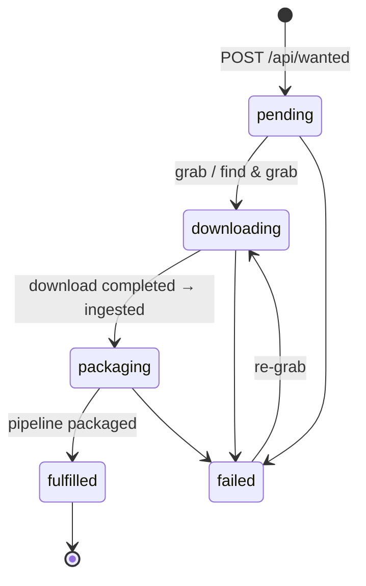
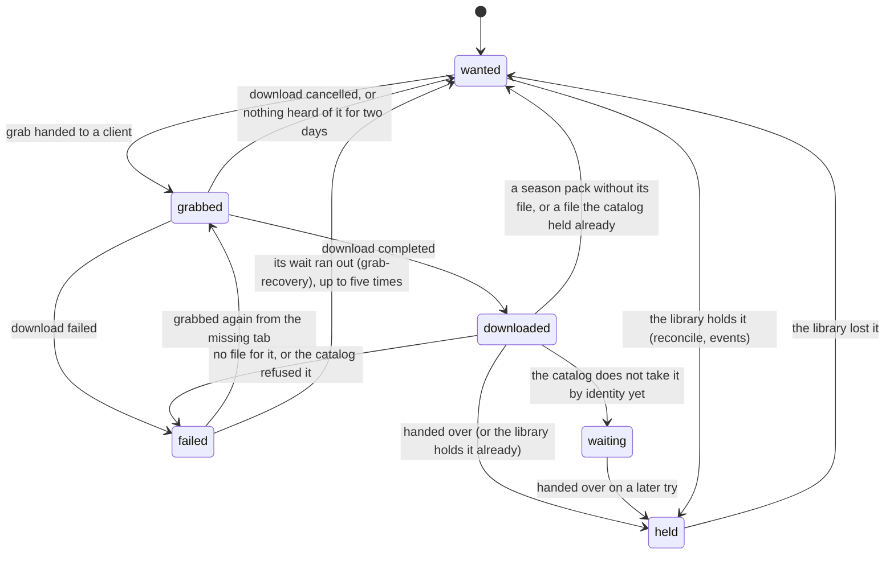

# The acquire service

`acquire` (Go, module `github.com/laedeli/acquire`) is the addon's brain and face.
It records requests, drives grabs, reacts to download and pipeline events, and
serves its console: a federated module the portal hosts. acquire has **no page
of its own** — the portal is the shell, and the console opens in place there,
at `/portal/app/acquire`, on the portal's sign-in. The service serves the
console's bundle under `/embed/` and its API under `/api/`, and sends a browser
that asks it for a page to the portal (see [the console](#the-console) and
[Deploying the addon](./deploying.md#where-the-console-is)).

## Request lifecycle

A request is a **WantedItem**. Its `status` walks a small state machine:



- **pending** — the request exists (v1 is auto-approved: it simply waits for an
  admin to grab it).
- **downloading** — a source was handed to a download client. The detail line
  records how, e.g. `grabbed NZB from <source> via nzbget` or `grabbed via qbittorrent`.
- **packaging** — the download finished; acquire resolved the video file and
  ingested it (`ingested; pipeline running`) — copied into the library's
  arrivals first when the download lies outside them (`downloaded; copying into
  the library` meanwhile, still *downloading*).
- **fulfilled** — the pipeline packaged the item; it now plays in chino. A
  request whose movie the library holds already — the catalog answers `409`
  naming the item — is fulfilled by that item.
- **failed** — any of: grab error, no releases (naming the sources that did not
  answer), download failed, no video file in the completed download, or ingest
  error. The detail line carries the reason. `pending` and `failed` requests are
  re-grabbable. A grab that is merely **refused** — no download client for the
  protocol, not enough free space, too many downloads at once, a source out of
  downloads for the day — leaves the request as it was; one that waits for room
  on the downloads volume says so in its detail line.

A request's movie is handed over with its TMDB identity (`identity`), and by
title alone, as before, when the catalog does not take ingest by identity or
refuses the identity. A request names a series, not its episodes, so a series
request's download cannot say which episodes it holds and still fails:
episodes are grabbed as [targets](#episodes-and-movies-acquire-tracks), from
the missing tab, where each file goes to the catalog by identity.

## Episodes and movies acquire tracks

The titles acquire tracks — series and movies imported from an earlier
automation service (`POST /api/import/intent`), their episodes derived from
TMDB (`POST /api/import/inventory`) — are **targets**: one per episode, one per
movie (a movie imported as released). A target is what acquire hunts; the
library's own word on what it holds comes from the catalog
([what the library holds](#what-the-library-holds)).

### A grab bound to targets

A **target grab** is one release handed to a download client for every
target it covers. What it covers is read from the release's name: one episode
(`S04E07`, `S04.E07`, `S04-E07`, `S04 EP07`, `4x07`, `Season 4 Episode 7`),
episodes of one season (`S04E07E08`, `S04E07-E08`, `S04E07-08`, `4x07x08` —
a run; `S01E01E03` holds episodes 1 and 3 only, which is no run), or whole
seasons, a **season pack** (`S01`, `S01-S03`, `S01.S02.S03`, `Season 2`) — of
a pack, the aired episodes of its seasons. A name of a daily show (a date) says
nothing. Of what it covers, the grab takes the targets that are wanted or
failed; held ones, and ones another grab is under way for, are left to that.

It is **reserved** first — one conditional update per target, so of two grabs
racing for a target exactly one takes it — then handed over through the same
hand-over a request's grab uses (the release file fetched by acquire, the
grab's id `tg_…` given to the gateway as the wanted item id), then bound to the
client's job. Once the add is sent, it and what records it run to their end
even if whoever asked goes away. A hand-over that does not happen fails no
target:

- **the source or the gateway cannot be had for now** — out of reach, failing
  (5xx), busy (429), timing out, refusing the key, an error page where the
  release file should be: the reservation goes, the targets stay wanted and
  are due again on a later sweep (half an hour), and a sweep stops its run
  when it is the gateway;
- **the release cannot be had** — its file gone from the source (404, 410),
  larger than acquire fetches, a link the endpoint policy refuses, or the
  client rejecting it: it is blocked for the targets, and the next release is
  taken;
- **the add's answer was lost** — sent, but the connection dropped or the
  answer could not be read, so the gateway may have it: nothing is undone. The
  reservation stays, saying so, the sweep leaves the targets alone, and the
  download's first event binds the grab — or, when none comes, the stale-grab
  sweep gives it up ([when a grab fails](#when-a-grab-fails)).

Grabs come from four places:

- the **backlog sweep**, when `search.autoGrab` allows it
  ([the sweep](#the-backlog-sweep));
- the console's **missing** tab: **grab** on a row, or **grab selected** for
  several — a search and grab of the best release an automatic grab may take,
  queued and done one at a time by acquire's grab worker. While as many
  downloads are in flight as the policy allows, a queued grab waits, unsearched,
  and says so; a grab refused for another reason (no client for the protocol,
  no room) is taken off the queue saying why;
- **releases** on a row: the target's typed search, each release saying what
  it holds; the one picked is grabbed for every wanted target it covers;
- the **search** tab: a release whose name holds episodes of a tracked series
  is grabbed for that series' targets. One of a series acquire does not track,
  or of several, is refused rather than filed as a movie request — and so is
  one that names a tracked series (and its year, when it names one) but no
  episode.

An automatic grab — the sweep's, and the missing tab's **grab** — takes a
release only when it holds the episode alone, or one run of at most ten
episodes in a row, every one of them missing: tracked, aired, monitored,
wanted or failed, not reserved by another grab, not left for someone to look
at. Anything more — a longer range (`S01E01-E12`), episodes that are not one
run, a season pack, several seasons — spends disk and bandwidth on what may
not be missing, or cannot go over as one file. It is grabbed when someone picks
it.

### A target's states



- **wanted** — not held, nothing under way. Aired, monitored and of a title
  whose holdings are known, it is **missing**.
- **grabbed** — a release that covers it is with a download client; the detail
  line says which (`grabbed NZB S04E07 from <source> via nzbget`).
- **downloaded** — the download finished; acquire is copying it into the
  arrivals, or handing it over.
- **waiting** — the catalog does not take episodes by identity yet: the copy
  stays, the client keeps the download, and the hand-over is tried again.
- **held** — the library holds it: the item, the item whose file it is held
  through when another episode's file covers it, and whether it plays.
- **failed** — its release failed it: the download failed, the download holds
  no file for it, or the catalog refused the file. The detail line says which.
  The release is blocked for it, so the next grab picks another, and it is
  wanted again after a wait ([when a grab fails](#when-a-grab-fails)). A
  failed target is still missing and can be grabbed again from the missing
  tab at any time; the sweep leaves it until its wait ran out.

### When a grab fails

Only its release fails a target. Such a target is **wanted again** after six
hours, twelve after a second failure, then a day and two days, the releases
that failed it blocked for it (for two weeks): the next grab takes another.
After the fifth failure in a row it stays failed, and its detail says so
(`failed 5 times, not tried again on its own: …`), for someone to look at; a
grab from the missing tab still takes it, and holding it ends the count.

Nothing else fails a target. A grab that cannot happen leaves it wanted
([a grab bound to targets](#a-grab-bound-to-targets)). **Cancelling** a target
grab's download in the downloads tab gives the grab up at once: its targets
are wanted again with the release blocked for them, and a hand-over still
waiting for the catalog stops, its copy deleted. A grab in flight that
**nothing is heard of for two days** — no event of its download, no import
working on it — and that the gateway does not know, by the grab's id or by its
client job, is given up and its targets are wanted again: a hand-over that died
before its job was bound, a job its client lost. A gateway that cannot be asked
gives nothing up.

The download's events move only targets that are still the grab's and in the
state the event expects: a completed event moves grabbed targets to downloaded,
a failed one fails grabbed targets. One for a grab that is done or given up —
a repeat, a late event — moves nothing, so a failed target stays failed for its
recovery.

The `grab-recovery` schedule, hourly, does both: it makes the failed targets
whose wait ran out wanted again, and gives up the stale grabs.

### From download to catalog

A target grab's finished download goes to the import worker, which takes it
like a request's: copied into the arrivals when it lies outside them, at
`<arrivals>/acquire/<grab>/<client>-<job>/`, handed over in place otherwise.
Then, file by file:

1. **Which file is which episode.** The download's videos — samples and the
   folders of extras left out — are read by their names: a file goes for the
   episodes its name holds (`Show.S04E07.mkv`, `Show.S04E07E08.mkv`), and a file
   named after nothing in a folder named after its episode for that episode. Of
   two files for one episode the larger is taken. A download whose only file
   names no episode is the release itself, and goes for what the release's
   name holds. A file that holds no target of the grab — an episode held
   already, or not wanted — is left out, and the grab's detail line names it
   with why; so is a file whose name lists episodes that are not one run
   (`S01E01E03`), which one file cannot go over for. A target no file holds
   fails by its release — except of a season pack, which only lets it go: it
   is wanted again, the pack blocked for it, nothing failed. When files of
   such a pack's download name no episode, one of them may be it: the client
   keeps the download.
2. **By identity.** Each file goes to `POST /api/ingest` as an episode of its
   series, named by every identity acquire holds of it — TMDB first, then TVDB
   and IMDb, since the catalog tries them in that order and the first that
   finds a series decides — with its season, its episode and, for a file of
   several, `episodeEnd`:

   ```json
   {"path": "/…/arrivals/acquire/tg_…/nzbget-42/Show.S04E07E08.mkv", "type": "episode",
    "title": "Show", "year": 2019, "series": {"tmdb": "97546", "tvdb": "362753"},
    "seasonNumber": 4, "episodeNumber": 7, "episodeEnd": 8}
   ```

   A movie target goes with its own identity (`identity: {tmdb, imdb}`), and by
   title alone when the catalog refuses it. An id that is not in its source's
   form is left out. A file of more than ten episodes in a row — only ever a
   pick — is not handed over, since the catalog takes at most ten in one file:
   its episodes fail by their release, saying so.
3. **The answer.** The first episode of a file is held by the item the catalog
   answers. The episodes the file covers after it are held through that item's
   file until the holdings name each one's own item: the answer's `covered`
   leaves out an episode the library held already, so it names no episode in
   order, and a reconcile of the series is asked for. The holder's packaged
   event — the only one a file of several gets — makes them all playable, and
   the holder's removal takes them all. A reconcile in the half hour after a
   hand-over does not want its episodes again for not being listed:
   katalog-api may not list them yet.
4. **Held already.** A `409` naming an item says the file was not taken in:
   the library holds what it is already. The episode it names — the file's
   first, by which the catalog refuses a file of several — or the movie is held
   by that item, with nothing recorded of the quality of a file acquire did not
   bring, and a reconcile of the series checks it. Every other episode of that
   file is not in the library by it: it is wanted again, with the release
   blocked for it, so the same release is not grabbed for it once more.
5. **A catalog without the contract.** The catalog from before ingest by
   identity answers an episode with `400` asking for its parent's catalog id;
   that, or a `422`, leaves the targets **waiting**. The copy stays, the
   download is not released in its client, and the hand-over is tried again
   half an hour after the first refusal and up to six hours apart. Any other
   refusal — a path outside the arrivals, an id in the wrong form — fails the
   targets by their release, with the catalog's reason.

The import moves only targets that are still the grab's and in flight: one a
reconcile held meanwhile stays held. A copy the catalog did not take — refused,
or held already — is deleted from the arrivals; only a hand-over waiting for
the catalog keeps its copy.

The download is **released** in its client — for the clients the deployment
runs, as a request's is — only when every target the grab still holds is held,
its file handed over and taken or held already, and nothing of it went over in
place: a file handed over where it lies (no `ACQUIRE_ARRIVALS_ROOT`, or a
download inside the arrivals) is the library's own, and its client keeps it.
Otherwise — a file refused, a target without a file, a file of several the
catalog held only the first episode of, a pack without a file for an episode
and with files that name none — the grab fails saying why, each target says
so, and the client keeps the download for someone to look at.

### What the library holds

acquire learns what the library holds from katalog-api's **holdings by
identity** (`GET /api/v1/holdings`, ADR-0012 of the platform), and never keeps
a copy of the catalog:

- **The reconcile.** For every tracked series and movie, acquire asks what the
  library holds of it — by its TMDB id, then its TVDB id, then its IMDb id, one
  per request — and makes its targets match: an episode the answer lists is
  held (with its item, the item whose file covers it, and whether it plays), a
  held one it does not list is wanted again. A series the catalog holds twice
  is answered as one, with the episodes of every copy: an episode both hold is
  held by the copy that plays, else one with a file of its own. A `404` for a
  title is "nothing of it is held" — unless the catalog holds a title of its
  name (and year, when both have one) **without any identity**, which no
  lookup by identity can find: then its holdings are unknown, saying so, until
  that item carries an identity. That is read from the listing, once per
  reconcile, when a lookup first finds nothing. A probe of the listing first
  tells a catalog that has no holdings endpoint (`404`, `405` or `501` there,
  or something that is not a page) from one that holds nothing: against the
  former, every title's holdings become unknown. A read side that is down, or
  refuses acquire's service account, keeps what was known and says why on
  each title.
- **When.** On the `holdings-reconcile` schedule (every six hours, the first
  run right after the first start), after titles are imported or their
  episodes derived, after a hand-over the catalog answered "held already" or
  that held a file of several, and on **ask the catalog now** in the missing
  tab (`POST /api/holdings/reconcile`). The reconcile runs in a worker of its
  own; the event that asks for it waits for nothing.
- **Between runs, the catalog's events.** `catalog.item.discovered` and
  `catalog.item.packaged` hold the target their identities name — an episode
  by its series' identities (`seriesExternalIds`) and numbers, a movie by its
  own (`externalIds`) — and `packaged` makes what the item holds playable,
  together with the episodes held through its file; it also asks the holdings
  to confirm the series, which covers a file of several acquire did not grab.
  `catalog.item.removed` makes what the item held wanted again: hunted again
  while the target and its title are monitored, not otherwise. An event
  without identities is matched by the item id acquire recorded.
- **Holdings unknown.** Until a title's holdings are known — never reconciled,
  or the catalog cannot answer — its targets are **holdings unknown**: not
  missing, not swept, and never grabbed automatically, because nothing says
  they are not on disk. The missing tab says how many titles that leaves out
  and why; the series tab marks each one.

A holding acquire tracks no target for is ignored: the library holds things
nobody monitors, and they must not become things acquire hunts. A movie the
library holds gets its one target.

### The backlog sweep

On its schedules (`backlog-sweep` every 30 minutes, `retry-failed` every 15
for targets whose searches keep finding nothing), the sweep takes ten targets:
wanted, aired, monitored with their title, of titles whose holdings are known,
not reserved by a grab under way, due — the ones never searched first, then the
ones searched longest ago. It searches each with its typed search and records
the outcome on the target:

| Outcome | Next search |
|---|---|
| **found** — releases an automatic grab may take | in twelve hours (on the next sweep when a grab was refused) |
| **none** — nothing, or nothing acceptable | 30 minutes after the first miss, doubling, up to a day |
| **error** — the search itself failed | the same backoff |

So every searched target moves to the back, and the sweep works through the
whole backlog.

The sweep **grabs only with `search.autoGrab`**, which is off by default: then
it only searches, and missing episodes are grabbed from the missing tab. With
it on, it grabs the best release an automatic grab may take of each target it
found releases for — never one whose title's holdings are unknown, and only
while a download slot is free (the downloads in flight the gateway reports,
and the grabs handed over it has not reported yet, against the downloads at
once of the search and grab settings). The first grab refused for room, a slot
or a client stops grabbing for the rest of that run; the gateway not taking
adds — out of reach, failing, its answer lost — stops the run: the rest would
be searched, spending the sources' allowance, for grabs that cannot be handed
over.

acquire reacts to these consumed events:

- `download.client.started` / `.progress` → record live telemetry (state, bytes,
  speed, ETA, seeders/health) and stream it to the console.
- `download.client.completed` → resolve the video file → `POST /api/ingest` →
  `packaging`, or, for a download outside the arrivals, queue its copy (below).
  A target grab's download is always queued for the import worker
  ([from download to catalog](#from-download-to-catalog)). Idempotent: a
  repeat (e.g. after a gateway restart) is ignored once the request or the
  grab has moved past the download, and queues nothing twice; one for a grab
  that failed or was given up moves nothing.
- `download.client.failed` → `failed` (with the client's error); a target
  grab's targets that are still grabbed fail by their release: blocked for
  them, wanted again after a wait ([when a grab fails](#when-a-grab-fails)).
- `catalog.item.packaged` → look up the request by item id → `fulfilled`; the
  targets the item holds are held and playable
  ([what the library holds](#what-the-library-holds)).
- `catalog.item.discovered` / `.removed` → the targets the item holds are held,
  or wanted again. These two are read in a consumer group of their own, the
  main group's id followed by `-catalog`: a group whose topics include one that
  does not exist is assigned nothing at all, so a catalog topic missing on an
  instance stops only these.

**Resolving the video file** from a completed download: acquire walks the download
folder as it sees it and picks the **largest** file with a video extension
(`.mkv .mp4 .m4v .avi .mov .ts .webm`). A file inside the library's arrivals it
ingests *in place*. With `ACQUIRE_ARRIVALS_ROOT` set, a file outside them — the
download clients the chart runs work on a volume of their own — is **copied in
first**: a worker takes one import at a time, copies the video and the
subtitle files the catalog pairs with it into
`<arrivals>/acquire/<request>/<client>-<job>/` (one sequential pass per file
into a temporary dot name, synced, checked by size and a SHA-256 of both ends,
renamed into place), and hands the copy over through the same
`POST /api/ingest`. A failed copy or hand-over leaves the download where it is
and is tried again, a minute after the first failure and up to an hour apart.
For the clients the deployment runs, acquire then releases the download in
the client, through the client's own API — an NZB right after its verified
copy, a torrent once qBittorrent stopped it at its seeding goal, removed with
its data. acquire never moves or deletes a client's files itself.

## HTTP API

Router: `go-chi`. Auth is an OIDC bearer verifier (issuer-only; roles from the
JWT `realm_access.roles`). If `OIDC_ISSUER` is unset, auth is disabled for local
dev (every caller is treated as admin).

| Method | Path | Who | Purpose |
|---|---|---|---|
| `GET` | `/healthz` | public | liveness |
| `GET` | `/readyz` | public | DB ping (503 when down) |
| `GET` | `/api/config` | public | what the console reads: the admin role and the `autoGrab` flag — whether **find & grab** has a source and a client to work with, not the sweep's `search.autoGrab` |
| `GET` | `/api/events` | any signed-in¹ | live stream: change pings + download telemetry |
| `GET` | `/api/wanted` | any signed-in | list requests |
| `POST` | `/api/wanted` | **user** or admin | create a request |
| `GET` | `/api/discover?q=` | any signed-in | TMDB search, flags in-library hits |
| `GET` | `/api/status?tmdbId=` | any signed-in | status of the newest request for a TMDB id |
| `POST` | `/api/wanted/{id}/grab` | **admin** | hand a magnet/URL to a client |
| `POST` | `/api/wanted/{id}/autograb` | **admin** | search the sources + grab the best release |
| `GET` | `/api/wanted/{id}/releases` | **admin** | the ranked releases for a request `{candidates, incomplete}` |
| `POST` | `/api/wanted/{id}/pick` | **admin** | grab one of them (sends back its `release` reference) |
| `GET` | `/api/search?q=&indexers=` | **admin** | manual search across the sources `{candidates, incomplete}` |
| `POST` | `/api/search/grab` | **admin** | grab a manual search result |
| `DELETE` | `/api/wanted/{id}` | **admin** | remove a request |
| `GET` | `/api/downloads` | any signed-in | live + recently finished downloads |
| `GET` | `/api/clients` | any signed-in | per-client health + aggregate speed |
| `POST` | `/api/downloads/{adapter}/{id}/{action}` | **admin** | `pause` \| `resume` \| `cancel` (a target grab's download: the grab is given up at once, its targets wanted again) |
| `GET` | `/api/setup` | **admin** | the setup checklist: sources, clients, grab policy |
| `GET` | `/api/health/system` | public | diagnostic checks (database, outbox, storage, sources, clients, clock); always 200 |
| `GET` | `/embed/…` | public | the console's bundle: `assets/remoteEntry.js`, its chunks and `assets/console.css` |
| `GET` | `/` and any other page | public | `302` to acquire's app in the portal (see [the console](#the-console)) |

¹ The stream carries download telemetry (progress, speed, ETA), so it is
authenticated. Clients read it with **fetch-streaming** rather than
`EventSource`, which cannot send an `Authorization` header. It emits `changed`
(refetch the lists) and `download` (one telemetry row, applied in place).

### The backlog and its grabs

| Method | Path | Who | Purpose |
|---|---|---|---|
| `GET` | `/api/missing?limit=` | any signed-in | the backlog: aired, monitored targets the library does not hold, of titles whose holdings are known, each with its state, detail and last search `{missing, holdings: {known, unknown, reason, lastAt}, autoGrab}` |
| `GET` | `/api/series` | any signed-in | every tracked series with episodes, held, missing, on their way, unaired, and whether its holdings are known |
| `GET` | `/api/counts` | any signed-in | the headline numbers, with the titles and targets of unknown holdings |
| `GET` | `/api/targets/{id}/search` | **admin** | a target's typed search `{candidates}`, each saying what it holds (`covers`, `pack`) |
| `POST` | `/api/targets/{id}/pick` | **admin** | grab one of them, bound to every wanted target it covers (sends back its `release` reference) |
| `POST` | `/api/targets/grab` | **admin** | queue a search and grab for each of `{"targetIds": […]}`, at most 200; `202 {queued, skipped}` |
| `POST` | `/api/holdings/reconcile` | **admin** | ask the catalog now what the library holds; `202` |

### Configuration API

Search sources, download clients and the search and grab policy are acquire's
own data, edited by admins only:

| Method | Path | Purpose |
|---|---|---|
| `GET` · `POST` | `/api/indexers` | list · add search sources |
| `PUT` · `DELETE` | `/api/indexers/{id}` | replace · remove a source |
| `POST` | `/api/indexers/test` · `/api/indexers/{id}/test` | try an unsaved · a saved source |
| `GET` · `POST` | `/api/download-clients` | list (with live gateway state) · add download clients |
| `PUT` · `DELETE` | `/api/download-clients/{id}` | replace · remove a client (`409` while downloads are in flight, and for a managed client) |
| `GET` | `/api/download-clients/types` | the client types the gateway runs |
| `POST` | `/api/download-clients/test` | reach a client through the gateway without saving it |
| `GET` · `PUT` | `/api/settings/search` | the search and grab policy: `preferProtocol`, `storageFloorGb`, `maxConcurrentGrabs` and `autoGrab` (the sweep grabs; `false` by default). A `PUT` replaces the whole document |

Writes send the revision they were based on in `If-Match` and get `409` when it
is stale; invalid content gets `422 {"fieldErrors":[…]}`. A **managed** client
(`"managed": true`) is one the deployment runs and declares in
`ACQUIRE_MANAGED_CLIENTS`; acquire writes it at start from that declaration, and
the API refuses to replace or remove it (`409`), though it can be tested. Secrets — source API
keys, client passwords and tokens — are write-only: omit to keep, a string to
replace, `{"clear":true}` to remove; reads say only whether one is set. Every
write is recorded in `settings_audit` without its values. See
[Search sources & NZB-first](./indexers-and-nzb.md) and
[Download gateway & clients](./download-gateway.md).

### Roles

| Role (default) | Env | Can |
|---|---|---|
| `zaentrum-user` | `ACQUIRE_USER_ROLE` | request titles |
| `zaentrum-admin` | `ACQUIRE_ADMIN_ROLE` | request **+** grab, auto-grab, remove, search, configure |

## The console

A Vite/React/TypeScript app on the nalet design system, built into the binary
with `go:embed` (source in `web/`, one container — no nginx sidecar). It is a
**federated module** and nothing else. The portal shell loads
`/embed/assets/remoteEntry.js` through its app proxy
(`/api/portal/apps/acquire/`), renders the exposed `Console` inside its own
React tree (React and react-dom are shared; no iframe) and links
`assets/console.css`. The shell signs the user in and hands the console the
API base and the user's access token; a `401` goes back to the shell, which
signs the user in again. acquire has no sign-in, no OIDC client and no page of
its own. **Realm roles come from the ACCESS token** — the ID-token profile
carries none, so reading it makes every user look like a non-admin.

Each tab has a hash route inside the app's route —
`/portal/app/acquire#/requests`, `#/downloads` and so on — which the launchpad
tiles open.

A browser that asks acquire itself for a page — `/`, or any other path the
standalone console of earlier versions answered — gets a `302` to
`ACQUIRE_PLATFORM_URL` followed by `/portal/app/acquire`. A search (`?q=`) is
carried and nothing else of the query, so a stale sign-in callback never
reaches the portal; the browser keeps the place in the console (`#/downloads`).
Without `ACQUIRE_PLATFORM_URL` the redirect goes to the portal's root,
`/portal/`, on the host the browser asked. Unknown `/api/` paths, missing files
of the bundle and other methods are a `404`, never a redirect or a page.

Tabs:

- **requests** — status pill, chosen release, and a live progress bar with speed,
  ETA and the client's own state inline. Admin actions per row: **find & grab**
  (automatic pick), **releases** (interactive search — see below), **magnet**
  (paste a magnet/`.torrent` URL), **remove**.
- **series** — every tracked series: held of its episodes, missing and on
  their way, or *holdings unknown* until the catalog has said what it holds.
- **missing** — the backlog, each row with its state and why: not searched
  yet, found, nothing found and when it is looked at again, queued, grabbed,
  downloaded, waiting for the catalog, failed. The header says how many
  titles' holdings are unknown and why (**ask the catalog now**), and whether
  the sweep grabs on its own. Admin actions: **grab** per row, **releases**
  per row (the target's typed search, a season pack among them), and **grab
  selected** for the rows ticked.
- **downloads** — every client job with progress and telemetry, pause/resume/
  cancel, under per-client health chips (speed, free disk, active news servers).
- **search** — free-text search across the sources, scoped to some of them if
  wanted, with every release scored and grabbable.
- **discover** — TMDB search + request; in-library titles are marked.
- **search sources** — add, edit, test, enable and remove newznab/torznab
  sources; their caps, today's usage against their limits, and their health.
- **clients** — the download clients: add, edit, test, enable and remove, with
  the gateway's live state and whether it runs the stored revision. The ones
  the addon runs itself carry a **managed** badge and can only be tested.
- **settings** — search and grab (protocol preference, free-space floor,
  downloads at once, and whether the backlog sweep grabs or only searches) and
  the quality profile.

On **requests** and **search**, admins see what setup still needs, with a link
to the tab that fixes it.

The **release picker** (`releases`) runs the same search auto-grab uses but
shows the ranked candidates — protocol, source, size, seeders and *why* each was
ranked where it was — so an admin can override the automatic choice.
- **Live progress** — each downloading request shows a progress bar with speed,
  ETA and the client's own state; a **downloads** table lists every job with
  per-client health chips and pause/resume/cancel.
- **Live updates** — the console reads `/api/events` with fetch-streaming, applying
  `download` rows in place and refetching on a `changed` ping (30s fallback poll).

## Storage

acquire owns a small Postgres schema (applied on boot, idempotent):

**`wanted_items`** — `id`, `tmdb_id`, `media_type` (`movie`/`series`), `title`,
`year`, `poster_url`, `requested_by` (Keycloak sub), `requested_at`, `status`,
`detail` (last status message), `item_id` (catalog id once created), `updated_at`.

**`grabs`** — `wanted_id` (FK, cascade), `adapter` (the client id),
`client_job_id`, `source` (the link with its credentials removed), plus the
release that won (`release_title`, `indexer`, `indexer_id`, `release_guid`,
`protocol`, `size_bytes`, `seeders`, `reason`) and the full link sealed in
`source_ct`; PK `(wanted_id, adapter, client_job_id)`. Terminal events
normally map back via the `wanted_item_id` the gateway echoes; this table is the
fallback when a restarted gateway no longer knows it.

**`indexers`** and **`indexer_usage`** — the search sources (API key sealed,
cached caps, health) and what each spent per UTC day.

**`imports`** — the finished downloads acquire copies into the arrivals and then
releases in their clients — every target grab's download, copied or not: the
files as the client reported them, the state (`pending`, `imported`, `done`,
`failed`), attempts, the last detail, the copy handed over and when to look
again. A target grab's download waiting for the catalog stays `pending`; one
the library did not get all of is `failed`, kept in its client.

**`download_clients`** — the download clients (secret sealed), with a generation
from one sequence that is the revision pushed to the gateway, and whether the
deployment manages the client (`managed`).

**`acquire_settings`** and **`settings_audit`** — the search and grab policy,
and who changed which configuration when (never the values).

**`titles`**, **`seasons`**, **`title_aliases`** and **`acquisition_targets`**
— the WANT model: what acquire tracks, by TMDB id with the TVDB and IMDb ids
searches need, and one target per episode or movie with its state and detail,
its last search (`search_outcome`, `search_detail`, `last_search_at`, and
`search_backoff_until` as its next due time), the grab that covers it
(`grab_id`) and the one it is reserved for while that grab's release is handed
over (`reserved_by`), how often its release failed it and when it is wanted
again (`grab_failures`, `retry_at`), when acquire last handed a file for it
over that the catalog took (`handed_over_at`), a grab asked for in the console
(`grab_requested_at`), and what the library holds of it (`held_item_id`,
`held_via` for an episode held through another's file, `held_playable`, the
release and its score). A title's `holdings_at` is when
its holdings were last learned, NULL while they are unknown, with
`holdings_error` saying why.

**`target_grabs`** — one row per release handed over for targets: the title,
the targets it was bound to, the client job, its state (`pending`, `grabbed`,
`downloaded`, `imported`, `failed`) and detail, what it covers, where it came
from (`via`: sweep, missing, pick, search) and the release that won, with its
link redacted (`source`) and the full one sealed (`source_ct`).
**`grab_targets`** records each target's file of a finished grab: the path
handed over, the episode run it covers, the item the catalog answered, and
what became of it (`imported`, `held` by an item of the library's own,
`waiting`, `missing`, `failed`).

**`downloads`** — one row per client job (`adapter` + `client_job_id`): state,
the client's native state, bytes, speed, ETA, seeders/health, timestamps. This is
a *projection* of the clients' state, so `wanted_id` is a soft reference — a
download whose request was deleted simply loses the link. Terminal rows keep the
telemetry the progress stream accumulated, and are never resurrected by a late
progress message.

## Configuration

| Env | Default | Purpose |
|---|---|---|
| `ADDR` | `:8080` | listen address |
| `OIDC_ISSUER` | — | realm issuer (blank ⇒ auth disabled, dev only) |
| `ACQUIRE_ADMIN_ROLE` | `zaentrum-admin` | admin role |
| `ACQUIRE_USER_ROLE` | `zaentrum-user` | request role |
| `ACQUIRE_PLATFORM_URL` | unset | the platform's address, scheme and host (`https://zaentrum.example.org`; a bare host means https): a browser that asks acquire for a page is sent to `/portal/app/acquire` there; unset sends it to `/portal/` on the host it asked |
| `PG_URL` (`DATABASE_URL`) | — | Postgres URL |
| `DOWNLOAD_GATEWAY_URL` | — | the gateway base URL |
| `KATALOG_URL` | — | catalog read API: what the library holds (holdings by identity), and the in-library check |
| `KATALOG_MANAGER_URL` | — | ingest target |
| `OIDC_TOKEN_URL` | — | token endpoint for the service account |
| `ACQUIRE_SVC_CLIENT_ID` / `ACQUIRE_SVC_CLIENT_SECRET` | — | client-credentials for gateway + ingest calls |
| `TMDB_API_KEY` | — | discovery (optional) |
| `ACQUIRE_CONFIG_KEY` | — | base64 32-byte key sealing stored credentials; without it none can be stored |
| `ACQUIRE_CONFIG_KEY_PREVIOUS` | — | the key before a rotation, still used to open values |
| `ACQUIRE_ENDPOINT_DENY` | — | comma list of hostnames / domain suffixes configuration may never point at |
| `ACQUIRE_ENDPOINT_ALLOW_INTERNAL` | `false` | allow cluster services in other namespaces |
| `POD_NAMESPACE` | service account namespace | acquire's own namespace, for the rule above |
| `ACQUIRE_PREFER` | `usenet` | seeds the protocol preference on first boot |
| `ACQUIRE_STORAGE_FLOOR_GB` | `500` | seeds the free-space floor on first boot |
| `ACQUIRE_MAX_CONCURRENT_GRABS` | `3` | seeds the downloads-at-once cap on first boot |
| `KAFKA_BROKERS` | — | bootstrap (blank ⇒ consumer off, service stays up) |
| `KAFKA_CERT_DIR` | `/etc/kafka-cert` | mTLS cert dir (`user.crt`/`user.key`/`ca.crt`); set to an empty value for a plaintext broker |
| `KAFKA_TOPIC_PREFIX` | `zaentrum-beta.` | tenant prefix |
| `KAFKA_GROUP_ID` | `acquire` | consumer group |
| `ACQUIRE_INBOX_ROOT` | `/var/lib/katalog/packages/_inbox` | staging folder on the media storage |
| `ACQUIRE_DOWNLOADS_ROOT` | `/var/lib/katalog/packages/_downloads` | where downloads are visible to acquire when a client names no folder of its own |
| `ACQUIRE_ARRIVALS_ROOT` | unset | the library's arrivals as acquire and the catalog see it, writable: finished downloads outside it are copied in before the hand-over; unset hands every download over in place |
| `ACQUIRE_DOWNLOADS_RESERVE` | `0` | bytes kept free on the volume the managed clients work on: a release for one of them waits until that volume holds twice its size for an NZB, its size for a torrent, plus this |
| `ACQUIRE_MANAGED_CLIENTS` | unset | the download clients the deployment runs: a JSON list in the shape the console writes a client in (`id`, `type`, `baseUrl`, `auth`, `username`, `secret`, `protocols`, `category`, `remotePath`, `localPath`), stored as managed clients at start; set but empty declares none |

Search sources and download clients are not environment settings: they are
added in the console. `INDEXER_URL` / `INDEXER_API_KEY` are no longer read. The
exception is the download clients the deployment runs itself: the addon chart
declares them in `ACQUIRE_MANAGED_CLIENTS`, from its Secret, and at start, before
its first push to the gateway, acquire creates them, brings them in line with
the declaration, takes over a client of the same id and type once no download
is in flight on it, and removes — or, while downloads are in flight, disables —
the managed clients no longer declared. Unset leaves the stored clients alone.

acquire calls the gateway, katalog-manager and katalog-api's holdings with a
**service-account** token (client-credentials), refreshed shortly before
expiry, so those calls are authenticated independently of any user. katalog-api
takes it when it carries the audience katalog-api accepts.

## Next

- [Download gateway & clients](./download-gateway.md) — where the bytes come from.
- [Search sources & NZB-first](./indexers-and-nzb.md) — where acquire searches and how `find & grab` chooses.
