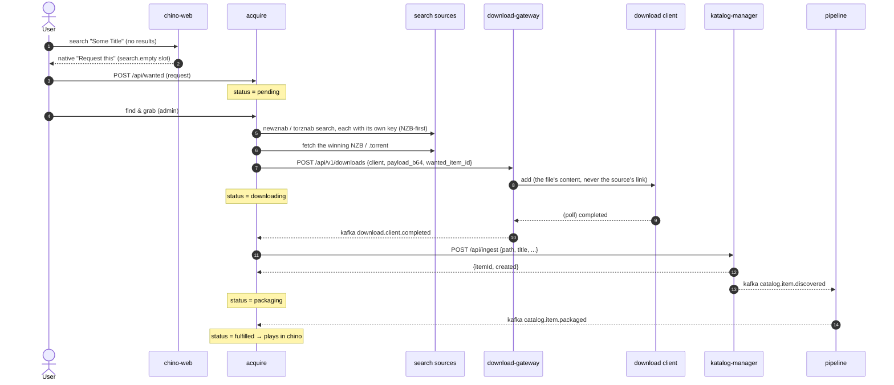
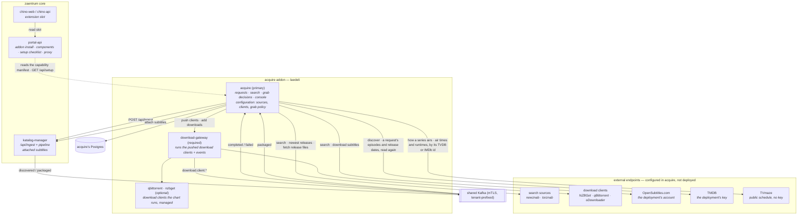

# Architecture

acquire is designed around one principle: **the platform core stays neutral, and
acquisition is an addon that plugs into two seams.** Nothing in the core mentions
requests or downloads; the addon is the only thing that does. This keeps the core
honest (it's a catalog + player for a library you own) and makes the whole
acquisition capability something you can add or remove cleanly.

> **Canonical contracts live platform-side.** This page explains how *acquire*
> uses the seams; the authoritative definition of each — the slot registry, the
> hosted-console federation contract, ingest, events, and addon identity — is
> the platform's [Extending zaentrum](https://github.com/zaentrum/zaentrum/wiki/extending)
> documentation. If this page and those ever disagree, those win.

## The seams

The core exposes extension points in its own vocabulary; the addon uses
them, and the core depends on none of them. Besides the two below, acquire
asks the catalog what the library holds by identity (holdings), and attaches
subtitles to titles (seam 3).

### Seam 1 — the UI extension registry (a native button, zero coupling)

The portal keeps a tiny `ui_extensions` registry table. Each row says “in **this
slot**, show a button with **this label** that goes to **this URL**.” Product
clients read their slots and render whatever they find as a **native** button —
so the core ships the *socket*, and the addon ships the *plug*.

- The registry lives in **portal-api** (`ui_extensions` table, migration `006`).
  CRUD is gated to an admin **or** an addon service account (the `zaentrum-addon`
  realm role, `PORTAL_ADDON_ROLE`); the per-slot read (`GET /api/portal/slots/{slot}`)
  is open to any signed-in user.
- **chino-web** renders the slot. Its search page mounts
  `<ExtensionSlot slot="search.empty">` — shown only when a search returns no
  titles and no people. In the core, that slot is empty, so **nothing renders**.
- **chino-api** forwards the browser's bearer to portal-api best-effort
  (`GET /api/v1/extensions?slot=`); an unreachable or unset portal simply yields
  an empty slot.

acquire *declares* the row in its capability manifest; the platform creates it
when an admin installs the addon (see [deploying](./deploying.md#install-it-in-the-portal)):

```json
"slots": [
  { "key": "search-request", "slot": "search.empty", "kind": "link",
    "label": "Request this", "icon": "download",
    "url": "/portal/app/acquire?q={q}#/discover", "ord": 10 }
]
```

Now “no results for _X_” grows a **Request this** button. Remove the addon and
the button is gone — the core never knew its name.

### Seam 2 — the neutral ingest contract (a file becomes a catalog item)

katalog-manager exposes `POST /api/ingest`: hand it an absolute path to a file
that already lives on the platform's storage, plus a title/type, and it creates a
catalog item + primary playback asset and **emits `catalog.item.discovered`** —
exactly what the scanner does for files it finds on its own. It “knows nothing of
where the file came from.”

- The path must sit under the media root **or** the packages root (guarded).
- It's **idempotent on the path**: re-ingesting a known file returns the existing
  item and fires nothing (no duplicate, no re-pipeline).
- `discovered` is the pipeline's front door — enrich → analyze → transcode →
  package all follow from it.
- A title goes **by its identity** (ADR-0012 of the platform): an episode by its
  series' TMDB, TVDB or IMDb id, its season and episode (and `episodeEnd` for
  one file of several), the catalog finding the series or making it; a movie
  with its own ids. acquire holds no catalog ids — they come back in the answer.

This is the seam that lets an addon put content into the catalog **without**
reaching into the catalog's internals. acquire owns one invariant here: it hands
over a file that is already in the library's arrivals — the finished download
itself when it lies there, else acquire's verified copy of it — and lets the
pipeline take it from `discovered` onward.

### Seam 3 — attached subtitles (a subtitle becomes a title's track)

katalog-manager adds a subtitle to a title it holds —
`POST /api/library/items/{id}/subtitles`, WebVTT or SubRip, its language, how
it came to be (`provider` for acquire's) — writes it beside the title's
package and registers it, so every player lists and plays it. Nothing is
packaged again. The same seam says what a title has (its subtitles, those
that came with its file and those added, and the fingerprint its original is
matched by), which subtitle languages the platform has set, and removes a
subtitle the caller added. It knows nothing of where a subtitle came from.

acquire uses it for [subtitles](./acquire.md#subtitles): it searches
OpenSubtitles.com for the languages a title lacks and adds the best match of
each, up to a daily limit. Without the seam, or without an account, it adds
nothing and says so.

## Event-driven by design

acquire **consumes** platform events and emits none of its own beyond its
internal schedule ticks (`acquire.schedule.due`, `acquire.schedule.saga.due`).
It reacts to events and issues commands at the edges (request, search, grab,
ingest) over plain HTTP. The bus carries the truth; HTTP carries the intent.



**Topics** (all carry a tenant prefix, e.g. `zaentrum-beta.`):

| Topic | Producer | acquire |
|---|---|---|
| `download.client.started` / `.progress` | download-gateway | **consumed** → live telemetry |
| `download.client.completed` | download-gateway | **consumed** → copy into the arrivals if needed, ingest (an episode by identity) |
| `download.client.failed` | download-gateway | **consumed** → mark failed |
| `catalog.item.discovered` | katalog-manager (on ingest, and the scanner) | **consumed** → the episode or movie its identities name is held |
| `catalog.item.packaged` | katalog-manager (pipeline) | **consumed** → mark fulfilled; what the item holds is playable; its subtitles are looked for first |
| `catalog.item.removed` | katalog-manager | **consumed** → what the item held is wanted again |

acquire's consumer starts at the **latest** offset (only new events; history is
not replayed) and is poison-safe (undecodable messages are skipped). The
catalog's `discovered` and `removed` are read in a consumer group of their own,
so a catalog topic an instance lacks stops only those. What the library holds
acquire also asks katalog-api by identity, on a schedule (`GET
/api/v1/holdings`): the events keep it between runs, the reconcile keeps it
right.

## Component map

The addon is two workloads, and optionally the two download clients the chart
can run (qBittorrent and NZBGet). Search sources and other download clients
are external endpoints: acquire stores where they are — keys and passwords
encrypted with `ACQUIRE_CONFIG_KEY` — and edits them in its console; the
clients the chart runs it stores as managed, from the deployment's
declaration. The portal shows the component group and acquire's setup
checklist, and never sees a configuration value.



| Component | Workload | Emits |
|---|---|---|
| `acquire` (primary) | `acquire` | `acquire.schedule.due`, `acquire.schedule.saga.due` |
| `download-gateway` (required) | first label of `DOWNLOAD_GATEWAY_URL`'s host | `download.client.started`, `.progress`, `.completed`, `.failed` |
| each managed client (optional) | first label of its address's host: `qbittorrent`, `nzbget` | — |

The manifest also declares the setup checklist: `GET /api/setup` answers
`ready`, `needs-setup` or `degraded` for **sources** and **clients** (required)
and **grab-policy** (optional), and each section links to the console tab that
edits it.

## The neutral-core property, restated

Every seam degrades to nothing:

- **Zero registry rows** → `ExtensionSlot` renders `null`; an unreachable portal →
  chino-api returns `[]`. No button, no trace.
- **Re-ingest of a known path** → no new item, no event. Idempotent.
- **No search sources / no download clients configured** → the gateway runs no
  clients, auto-grab is off, and the setup checklist says what is missing. The
  service stays up.

That's what makes acquisition an *addon* and not a fork: install it for the whole
capability, remove it for a clean, neutral platform.

## Next

- [The acquire service](./acquire.md) — the request lifecycle, API, console and schema.
- [Download gateway & clients](./download-gateway.md) — the download plane.
- [Search sources & NZB-first](./indexers-and-nzb.md) — where acquire searches and how auto-grab picks a release.
- [Deploying the addon](./deploying.md) — installing it on a platform.
